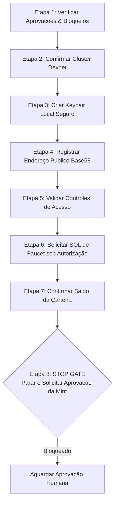

# NOOBCOIN — RUNBOOK OPERACIONAL PARA CRIAÇÃO E GESTÃO DE CARTEIRA DEVNET
## Projeto NoobRPG | Pacote `@noobrpg/solana-worker` | Missão 30F

---

> [!WARNING]
> **AVISO DE SEGURANÇA E RESTRIÇÃO OPERACIONAL:**
> Este documento é um **guia procedural estritamente proposto** para orientar uma futura missão caso ela receba autorização humana formal.
> **NENHUM COMANDO LISTADO NESTE DOCUMENTO DEVE SER EXECUTADO DE FORMA AUTÔNOMA.**
> Nesta Missão 30F:
> - Nenhuma chave privada ou seed phrase foi gerada.
> - Nenhuma carteira foi importada ou conectada.
> - Nenhum SOL de faucet foi solicitado.
> - Nenhuma transação on-chain foi assinada ou enviada.
> - Nenhum mint de token foi criado.

---

## 1. Mapeamento de Arquivos Sensíveis e Proteções Anti-Vazamento

Durante a execução futura deste runbook, o único arquivo que conterá material criptográfico confidencial (chave privada) é:

| Arquivo Sensível Gerado | Localização Físico | Classificação | Proteção Aplicada |
| :--- | :--- | :---: | :--- |
| **Keypair do Fee Payer** | `packages/solana-worker/secrets/devnet-payer-keypair.json` | 🔴 **SECRETO** | `.gitignore` (`*keypair*.json`), ACL restrita ao usuário do SO, fora do bundle do cliente. |
| **Configuração Local do Worker** | `packages/solana-worker/.env.worker` | 🟡 **CONFIDENCIAL** | `.gitignore` (`.env*`), aponta apenas para o caminho do arquivo sem embutir a chave. |
| **Chave Pública (Endereço)** | `packages/solana-worker/.env.worker.example` | 🟢 **PÚBLICO** | Pode ser documentado publicamente como string Base58. |

### Barreiras Mandatórias Antes de Iniciar
1. **Regra de Git:** Executar `git status --ignored` para confirmar que a pasta `packages/solana-worker/secrets/` e o arquivo `devnet-payer-keypair.json` aparecem listados na seção de arquivos ignorados (`Ignored files`).
2. **Salvaguarda Automatizada:** Executar `npm test --workspace=@noobrpg/server` para validar a suíte `security_credentials_guard.test.ts`.
3. **Proibição de Comandos Cat/Type:** Nunca imprimir o conteúdo de arquivos `*keypair*.json` no terminal, logs ou relatórios markdown.

---

## 2. Etapas Sequenciais Propostas (Para Execução Futura Sob Demanda)



---

### ETAPA 1 — Verificar Aprovações e Bloqueios Operacionais

Antes de qualquer ação no terminal:
1. Confirmar que o pacote [NOOBCOIN_HUMAN_APPROVAL_PACKAGE.md](file:///D:/NoobRPG/docs/NOOBCOIN_HUMAN_APPROVAL_PACKAGE.md) foi assinado e deliberado pelo proprietário.
2. Confirmar o status da infraestrutura Cloudflare R2:
   - Status: 🟢 **`RESOLVED (Rotated & Verified)`** — Novas credenciais aplicadas localmente em arquivos seguros não versionados e conectividade S3 comprovada com o bucket `noobrpg-assets`.
3. Confirmar que o repositório está em estado limpo (`git status`).

---

### ETAPA 2 — Confirmar o Cluster Devnet

Validar que a conexão local aponta estritamente para a Solana Devnet oficial e que o Genesis Hash coincide com a rede de testes:

```bash
# Executar a verificação read-only oficial sem transações:
cmd /c npx tsx packages/solana-worker/scripts/devnet_readonly_smoke.ts
```

**Critério de Sucesso:**
- Saída: `GENESIS HASH DEVNET VALIDADO COM SUCESSO: EtWTRABZaYq6iMfeYKouRu166VU2xqa1wcaWoxPkrZBG`.
- Status: `PASS — READ-ONLY DEVNET VERIFIED`.

---

### ETAPA 3 — Criar a Carteira de Teste em Ambiente Local Seguro

*(Passo a ser executado exclusivamente na futura missão de geração de carteira)*

1. Criar o diretório de segredos do worker (caso não exista):
   ```powershell
   # No Windows PowerShell:
   New-Item -ItemType Directory -Force -Path "packages/solana-worker/secrets"
   ```
2. Gerar o keypair local via Solana CLI oficial, sem passphrase de BIP39 para evitar interatividade no daemon:
   ```bash
   solana-keygen new --outfile packages/solana-worker/secrets/devnet-payer-keypair.json --no-bip39-passphrase --silent
   ```
3. Aplicar permissões restritas no arquivo:
   - **No Windows (PowerShell):**
     ```powershell
     icacls "packages\solana-worker\secrets\devnet-payer-keypair.json" /inheritance:r /grant:r "${env:USERNAME}:(R,W)"
     ```
   - **No Linux/macOS:**
     ```bash
     chmod 700 packages/solana-worker/secrets
     chmod 600 packages/solana-worker/secrets/devnet-payer-keypair.json
     ```

---

### ETAPA 4 — Registrar Somente o Endereço Público (Base58)

1. Obter exclusivamente a chave pública do arquivo recém-gerado:
   ```bash
   solana-keygen pubkey packages/solana-worker/secrets/devnet-payer-keypair.json
   ```
2. Registrar a chave pública obtida (ex.: `7xKXtg...`) no arquivo de configuração do worker `.env.worker`:
   ```ini
   SOLANA_NETWORK=devnet
   SOLANA_RPC_URL=https://api.devnet.solana.com
   SOLANA_COMMITMENT=confirmed
   SOLANA_PAYER_KEYPAIR_PATH=./secrets/devnet-payer-keypair.json
   SOLANA_PAYER_PUBLIC_KEY=<CHAVE_PUBLICA_BASE58_OBTIDA>
   WORKER_DRY_RUN=true
   ```
3. **PROIBIÇÃO:** Sob nenhuma hipótese copiar ou registrar os 64 inteiros do array de bytes secretos em qualquer arquivo de texto além do JSON de destino.

---

### ETAPA 5 — Validar o Endereço e os Controles de Acesso

1. Verificar que o arquivo gerado não foi rastreado pelo Git:
   ```bash
   git status --short
   ```
   *O arquivo `devnet-payer-keypair.json` NÃO PODE aparecer em arquivos modificados ou untracked.*
2. Verificar que o arquivo é ignorado:
   ```bash
   git check-ignore packages/solana-worker/secrets/devnet-payer-keypair.json
   ```
   *Deve retornar o caminho do arquivo indicando correspondência à regra do `.gitignore`.*
3. Executar o teste de integridade de credenciais:
   ```bash
   cmd /c npx tsx --test packages/server/tests/security_credentials_guard.test.ts
   ```

---

### ETAPA 6 — Solicitar SOL de Teste (Airdrop Devnet) sob Autorização Específica

> [!CAUTION]
> Esta etapa consome recursos do faucet público da Devnet e altera o estado do ledger on-chain.
> Exige autorização humana expressa prévia.

Solicitar 1 ou 2 SOL de teste para o endereço público gerado:
```bash
solana airdrop 1 <CHAVE_PUBLICA_BASE58> --url https://api.devnet.solana.com
```

*Nota sobre Faucets Públicos:* Caso o RPC oficial retorne `429 Too Many Requests`, aguardar a janela de rate limit (normalmente 1 hora) ou recorrer a faucets web alternativos de Devnet aprovados, inserindo estritamente a chave pública.

---

### ETAPA 7 — Confirmar o Saldo da Carteira

Consultar o saldo da conta pública na Devnet para assegurar que há fundos suficientes para pagar o aluguel da conta de teste:

```bash
solana balance <CHAVE_PUBLICA_BASE58> --url https://api.devnet.solana.com
```

**Critério de Sucesso:**
- Saldo retornado $\ge 1.0\text{ SOL}$.

---

### ETAPA 8 — STOP GATE: Parar e Solicitar Nova Aprovação

Após a validação do saldo da carteira do fee payer:
1. **PARAR IMEDIATAMENTE A EXECUÇÃO.**
2. **NÃO CRIAR O MINT DO TOKEN.**
3. **NÃO EXECUTAR `spl-token create-token`.**
4. Apresentar o endereço público e o saldo comprovado para nova deliberação humana.
5. Aguardar autorização específica para o ciclo de criação da mint e emissão do suprimento piloto (1.000.000 tNOOB).

---

## 3. Procedimento de Contingência: Substituição de Chave Comprometida

Caso haja suspeita de comprometimento da chave privada ou exposição acidental:

1. **Parada Imediata do Worker:**
   ```bash
   # Encerrar o processo do worker no terminal (Ctrl+C ou SIGINT)
   ```
2. **Ativação do Kill Switch no Banco de Dados:**
   ```sql
   UPDATE noobcoin_config SET value = '1' WHERE key = 'distribution_paused';
   ```
3. **Drenagem ou Abandono de Fundos de Teste:**
   - Como os fundos são de Devnet e não possuem valor financeiro, a carteira pode ser simplesmente descartada.
4. **Remoção Segura do Arquivo Local:**
   ```powershell
   # No Windows PowerShell:
   Remove-Item -Force "packages/solana-worker/secrets/devnet-payer-keypair.json"
   ```
5. **Geração de Nova Carteira:**
   - Reiniciar a partir da **Etapa 3** deste Runbook com um novo arquivo.

---

## 4. Resumo de Diretrizes para o Operador Humano

- Nunca compartilhe a pasta `secrets/` via zip, chat ou e-mail.
- Ao solicitar suporte ou relatar problemas, compartilhe exclusivamente a chave pública (`Base58`) e o hash da transação (`Signature`).
- As propostas técnicas da Missão 30E (SPL Token Original, 1.000.000 tNOOB, 6 decimais) permanecem dependentes de confirmação antes do prosseguimento da Etapa 8.
