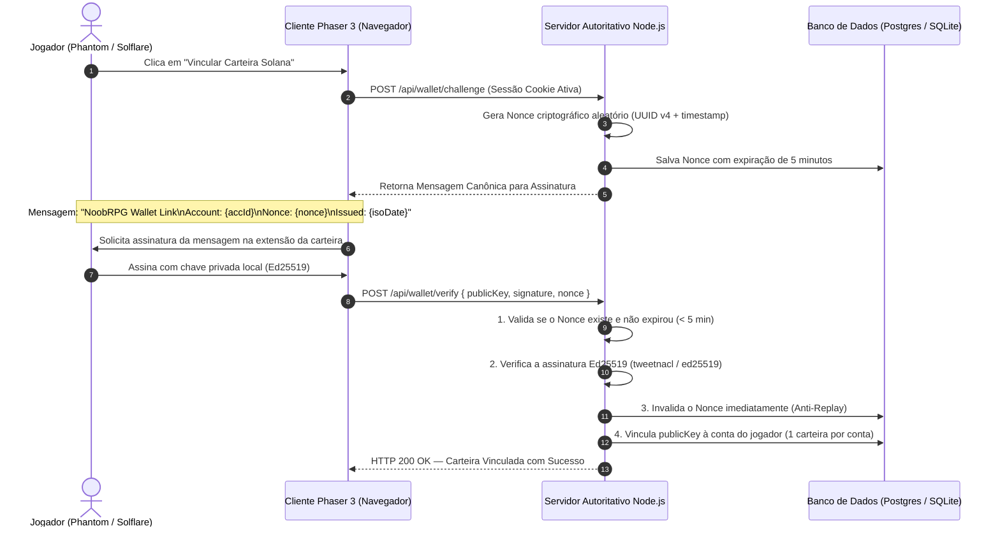
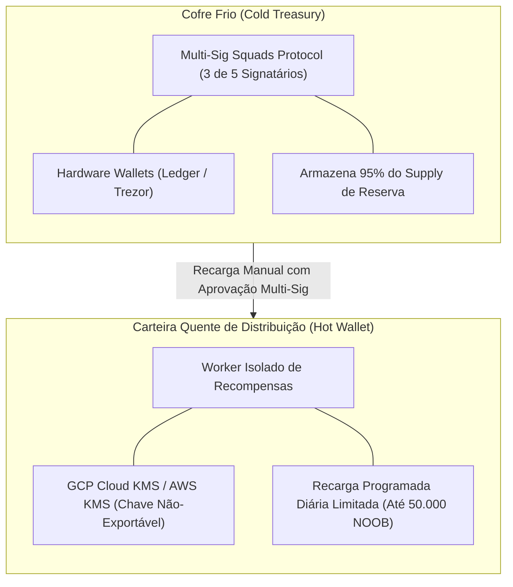

# NOOBCOIN — PLANO DE SEGURANÇA E CUSTÓDIA DE CARTEIRAS
## Projeto NoobRPG | Antigravity Pro | Missão 29

> [!CAUTION]
> **REGRAS INVIOLÁVEIS DE SEGURANÇA CRIPTOGRÁFICA:**
> 1. **NUNCA SOLICITAR FRASE-SEMENTE (SEED PHRASE) OU CHAVE PRIVADA AO JOGADOR.**
> 2. **NUNCA ARMAZENAR CHAVES PRIVADAS DE CARTEIRAS PESSOAIS NO BANCO DE DADOS.**
> 3. **NUNCA INSERIR SEGREDO, TOKEN PRIVADO OU CHAVE MESTRE EM CÓDIGO-FONTE OU BUNDLE DO CLIENTE WEB.**
> 4. **A CUSTÓDIA DE ATIVOS PESSOAIS É 100% EXCLUSIVA DO JOGADOR (SELF-CUSTODY).**

---

## 1. Separação de Identidades: Conta de Jogo vs. Chave Pública Solana

O NoobRPG adota o princípio de **desacoplamento total de identidades**:
- **Identidade de Jogo:**
  - Gerenciada pelo `AuthService` com credenciais hasheadas em **Argon2id** (`accounts` e `account_sessions`).
  - Sessões autenticadas via cookies protegidos com flags `HttpOnly`, `SameSite=Strict` e `Secure`.
- **Identidade Blockchain:**
  - Representada unicamente pela **chave pública (Public Key Ed25519)** da carteira Solana do jogador (ex: Phantom, Solflare, Backpack).
  - O banco de dados do jogo registra exclusivamente a chave pública autorizada (string Base58 de 44 caracteres), jamais a semente mnemônica ou segredos privados.

---

## 2. Processo de Vinculação Criptográfica de Carteiras (SIWS)

Para vincular uma carteira pública à conta de jogo, o jogador deve comprovar matematicamente a posse da chave privada sem jamais revelá-la, utilizando o padrão **Sign-In with Solana (SIWS)** com assinaturas Ed25519.

### 2.1 Fluxo de Vinculação com Nonce e Anti-Replay

### 2.2 Blindagens contra Ataques de Vinculação
1. **Proteção contra Replay Attack:** Todo nonce possui validade estrita de 300 segundos e é deletado do banco na primeira tentativa de uso (consumo de uso único).
2. **Exclusividade de Carteira (1:1 Binding):** Uma chave pública Solana não pode ser vinculada a múltiplas contas do jogo simultaneamente, inviabilizando fazendas de contas compartilhando a mesma carteira.
3. **Cooldown de Troca de Carteira:** A desvinculação ou alteração de carteira impõe uma quarentena de segurança de **7 dias**, durante a qual nenhuma transferência on-chain é autorizada para o novo endereço, prevenindo roubo de saldo por invasão de sessão.

---

## 3. Gestão e Rotação de Chaves de Infraestrutura (Cofres e Custódia)

A infraestrutura de emissão do NoobRPG divide o gerenciamento de fundos em dois níveis estritamente isolados:

### 3.1 Carteira Quente de Distribuição (Hot Wallet)
- Utilizada unicamente pelo worker isolado de background para assinar instruções de distribuição de recompensas aprovadas no ledger.
- A chave privada **não reside em texto claro no disco ou em variáveis de ambiente**, sendo gerenciada via módulo criptográfico seguro (**AWS KMS** ou **GCP Cloud KMS**) que executa a assinatura remota.
- **Teto Máximo de Liquidez (Drain Cap):** O saldo da carteira quente nunca excede a necessidade prevista para 24 horas (máximo de 50.000 NOOB). Em caso de comprometimento do worker, as perdas são rigidamente limitadas ao saldo do dia.

### 3.2 Tesouraria Fria (Cold Treasury)
- Controlada exclusivamente por **Multi-Sig on-chain** (protocolo Squads na Solana) exigindo quórum mínimo de **3 de 5 signatários humanos**.
- Nenhum membro individual da equipe possui poder unilateral de movimentação de fundos da tesouraria.

---

## 4. Procedimentos de Emergência e Circuit Breaker

### 4.1 Kill Switch Global de Distribuição
Em caso de anomalia econômica, suspeita de exploit ou volatilidade anormal:
1. O comando administrativo de emergência ativa `distribution_paused = '1'` na tabela `noobcoin_config`.
2. O `NoobCoinRewardService` rejeita instantaneamente qualquer nova criação de recompensa com o código `DISTRIBUTION_PAUSED`.
3. O worker de distribuição suspende o envio de transações on-chain de imediato sem corromper o histórico prévio.

### 4.2 Reconciliação Contábil Contínua
- A cada 60 minutos, uma rotina de verificação computa:
  $$\Delta = \text{Saldo On-Chain da Hot Wallet} + \sum \text{Recompensas Pagas} - \text{Total Depositado da Tesouraria}$$
- Se $\Delta \ne 0$, o sistema congela a fila de envio e envia alertas de prioridade máxima via webhook corporativo (PagerDuty/Discord Ops).

---

## 5. Proteção de Endpoints e Mitigação de Ataques Web

1. **Rate Limiting Estrito:** Endpoints de consulta de recompensas limitados a 10 requisições por minuto por IP e por sessão autenticada.
2. **Mascaramento em Logs:** Nenhuma chave pública inteira é exibida em logs não autenticados (apenas formato truncado `4h8z...9K2m`). Frases-semente e senhas são banidas por filtros de sanitização no logger.
3. **WAF e Proteção DDoS:** Camada Cloudflare ativa na borda para mitigar requisições automatizadas maliciosas.
