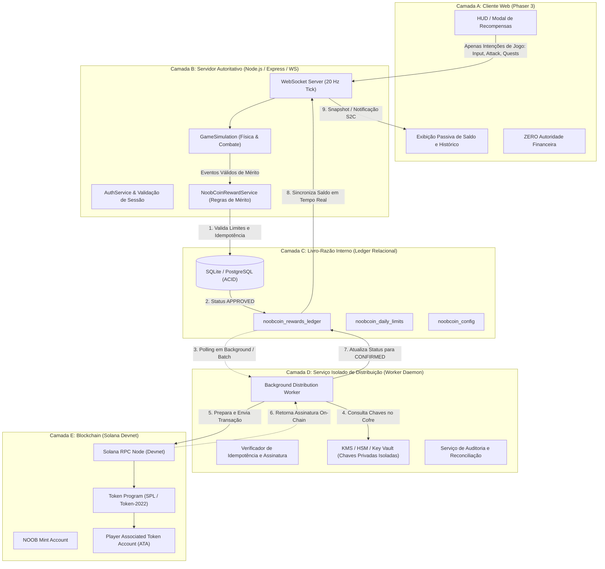

# NOOBCOIN — ARQUITETURA TÉCNICA E SEGURANÇA EM CAMADAS
## Projeto NoobRPG | Antigravity Pro | Missão 29

Este documento especifica a arquitetura em 5 camadas para a integração segura, auditável e desacoplada do NoobCoin (NOOB) ao ecossistema NoobRPG, garantindo que operações blockchain de alta latência jamais interfiram na simulação em tempo real do jogo (20 Hz).

---

## 1. Visão Geral da Arquitetura em Cinco Camadas

---

## 2. Responsabilidades por Camada e Fronteiras de Segurança

### 2.1 Camada A — NoobRPG Client (Phaser 3 / TypeScript)
- **Responsabilidade:**
  - Renderizar visualmente a interface de usuário (HUD, medalhas, toasts e histórico de transações).
  - Exibir o saldo atualizado e histórico de recompensas fornecido autoritativamente pelo servidor.
  - Oferecer interface para solicitação de vinculação de carteira pública Solana (via assinatura de mensagem criptográfica).
- **Fronteira de Segurança (Zero Client Trust):**
  - O cliente **NUNCA** envia valores de recompensa.
  - O cliente **NÃO PODE** solicitar diretamente a criação de tokens.
  - O cliente **NUNCA** acessa, manipula ou possui chaves privadas da tesouraria do jogo.
  - Nenhuma decisão financeira ocorre no navegador do jogador.

### 2.2 Camada B — Servidor Autoritativo de Gameplay (Node.js / Colyseus-like)
- **Responsabilidade:**
  - Validar a sessão do jogador via tokens criptográficos `HttpOnly`.
  - Executar o loop autoritativo de simulação a 20 Hz (movimento, combate, missões, coleta).
  - Avaliar gatilhos legítimos de mérito (ex: conclusão de temporada, primeiro abate de chefe mundial, conquistas mestre).
  - Aplicar regras de elegibilidade (nível mínimo do personagem, tempo de jogo, ausência de flags de moderação).
  - Encaminhar intenções de concessão de recompensa para o `NoobCoinRewardService`.
- **Fronteira de Segurança:**
  - Desacoplamento temporal estrito: Chamadas de rede externa (RPCs Solana) são **proibidas no thread principal de simulação**. Qualquer operação de I/O externo não bloqueia o tick rate de 50 ms (20 Hz).

### 2.3 Camada C — Livro-Razão Interno (Relational Ledger)
- **Responsabilidade:**
  - Garantir integridade transacional estrita (ACID) no SQLite (desenvolvimento/testes) e PostgreSQL (produção).
  - Rastrear o ciclo de vida completo de cada recompensa através da máquina de estados:
    $$\text{PENDING} \longrightarrow \text{APPROVED} \longrightarrow \text{QUEUED} \longrightarrow \text{SUBMITTED} \longrightarrow \text{CONFIRMED}$$
  - Impor restrições de unicidade (`UNIQUE(idempotency_key)`) impedindo qualquer duplicação por timeout ou reconexão.
  - Computar e aplicar tetos diários (`noobcoin_daily_limits`) por personagem e por conta.
- **Fronteira de Segurança:**
  - Quantidades armazenadas estritamente em **inteiros brutos mínimos de 64 bits (`amount_raw`)** com 6 casas decimais (1 NOOB = $1.000.000$ unidades), banindo qualquer aritmética de ponto flutuante IEEE-754.
  - Estados `SUBMITTED` e `CONFIRMED` mantidos inativos até implementação do worker de distribuição on-chain.

### 2.4 Camada D — Serviço Isolado de Distribuição (Distribution Worker)
- **Responsabilidade:**
  - Processo em background independente (Worker Daemon) que roda isolado dos servidores de jogos.
  - Monitora o ledger para recompensas no estado `APPROVED`, transiciona para `QUEUED` e prepara transações em lote (*batching*).
  - Interage com módulos de segurança de hardware (HSM) ou serviços de gerenciamento de chaves na nuvem (AWS KMS / GCP Cloud KMS) para assinar transações da carteira quente (*Hot Wallet*).
  - Gerencia timeouts, dead-letter queues (DLQ) e re-tentativas com backoff exponencial.
- **Fronteira de Segurança:**
  - Isolamento de rede: O worker opera em VPC privada sem portas abertas para a internet pública, acessando apenas o banco de dados interno e o nó RPC da Solana.
  - Limite diário de movimentação por carteira quente (Hot Wallet Drain Prevention).

### 2.5 Camada E — Solana Blockchain (Devnet Inicialmente)
- **Responsabilidade:**
  - Executar a liquidação final e custódia pública dos tokens.
  - Gerenciar as contas de token associadas (ATAs - *Associated Token Accounts*) dos jogadores.
  - Fornecer comprovantes de transação transparentes e imutáveis (`onchain_tx_signature`).
- **Fronteira de Segurança:**
  - Na fase atual e na Missão 29: **NENHUMA transação é enviada e nenhuma mint é criada**.
  - No futuro: Apenas a rede Solana Devnet será utilizada em testes aprovados; a mainnet exigirá autorização explícita e governança formal.

---

## 3. Máquina de Estados e Transições do Livro-Razão

A tabela abaixo define as transições permitidas no ledger e as regras de bloqueio:

| Estado Atual | Próximo Estado Permitido | Gatilho / Condição | Inativo na Missão 29? |
| :--- | :--- | :--- | :---: |
| **`PENDING`** | `APPROVED` | Validação de regras e limites diários aprovada no servidor | Não (Ativo) |
| **`PENDING`** | `REJECTED` | Limite diário estourado ou falha de elegibilidade | Não (Ativo) |
| **`PENDING`** | `CANCELLED` | Cancelamento administrativo ou encerramento de evento | Não (Ativo) |
| **`APPROVED`** | `QUEUED` | Coletado pelo worker de distribuição para empacotamento em lote | Não (Ativo) |
| **`APPROVED`** | `CANCELLED` | Anulação por auditoria de segurança antes do envio on-chain | Não (Ativo) |
| **`QUEUED`** | `SUBMITTED` | Transação transmitida ao nó RPC da Solana com hash gerado | **Sim (Inativo)** |
| **`QUEUED`** | `CANCELLED` | Falha estrutural de preparação de lote | Não (Ativo) |
| **`SUBMITTED`** | `CONFIRMED` | Bloco finalizado na Solana com compromisso `confirmed`/`finalized` | **Sim (Inativo)** |
| **`SUBMITTED`** | `CANCELLED` | Transação rejeitada ou expirada na mempool da Solana | Não (Ativo) |
| **`CONFIRMED`** | *(Nenhum)* | **Estado Terminal Definitivo** (Imutável) | - |
| **`REJECTED`** | *(Nenhum)* | **Estado Terminal Definitivo** (Imutável) | - |
| **`CANCELLED`** | *(Nenhum)* | **Estado Terminal Definitivo** (Imutável) | - |

---

## 4. Reconciliação Contábil e Tolerância a Falhas

1. **Procedimento de Reconciliação Periódica:**
   - Um cronjob de auditoria compara a soma total de recompensas no estado `CONFIRMED` no banco relacional com o saldo da conta de distribuição e a emissão líquida registrada na mint account da Solana.
   - Qualquer discrepância $\Delta \ne 0$ aciona um alerta de severidade crítica P0 e pausa automaticamente o subsistema de distribuição via flag `distribution_paused = '1'`.
2. **Circuit Breaker Automático:**
   - Se a taxa de erro nas transações do worker exceder 5% em uma janela de 10 minutos, o envio é suspenso imediatamente.
3. **Resiliência a Reinicializações:**
   - Como todos os registros residem em tabelas relacionais com transações atômicas, quedas repentinas de energia ou reinicializações de pod do servidor não causam perda de dados nem duplicação de saldo.
