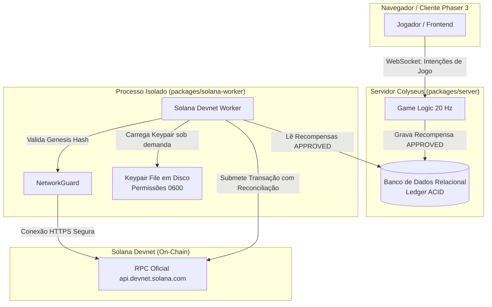
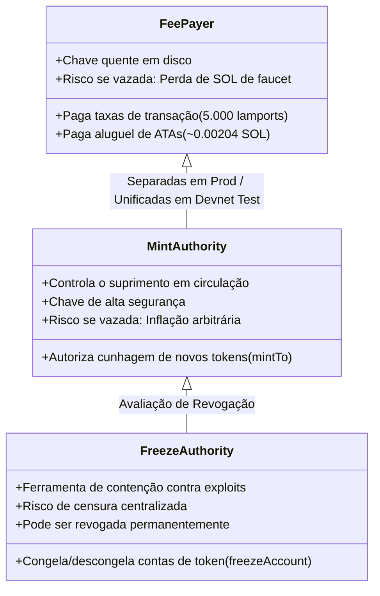

# NOOBCOIN — PLANO DE CUSTÓDIA DE CARTEIRA E GERENCIAMENTO DE CHAVES (DEVNET)
## Projeto NoobRPG | Pacote `@noobrpg/solana-worker` | Missão 30F

---

## 1. Objetivo e Declaração de Escopo

Este documento define formalmente a arquitetura de segurança, o modelo de custódia e o ciclo de vida de chaves criptográficas para a futura carteira de testes da **NoobCoin (tNOOB)** na **Solana Devnet**.

> [!IMPORTANT]
> **RESTRIÇÃO DA MISSÃO 30F:**
> Esta missão é estritamente de documentação, planejamento arquitetural e auditoria de segurança.
> **Nenhuma chave privada ou seed phrase foi gerada.**
> **Nenhuma carteira foi importada ou conectada.**
> **Nenhum airdrop de SOL ou transação on-chain foi executado.**
> **Nenhum mint de token foi criado ou alterado.**

---

## 2. Status dos Bloqueios Operacionais

| Recurso / Subsistema | Estado Atual | Condição para Desbloqueio |
| :--- | :---: | :--- |
| **Solana Devnet Worker** | 🟡 **`READY FOR HUMAN REVIEW`** | Deliberação humana explícita do termo de aprovação da Missão 30E e validação deste plano de custódia. |
| **Operações On-Chain (Devnet)** | 🔴 **`BLOCKED (No-Keypair Policy)`** | Execução controlada das etapas 1 a 5 do Runbook Operacional sob supervisão humana. |
| **Infraestrutura Cloudflare R2** | 🟢 **`RESOLVED (Rotated & Verified)`** | Novas credenciais geradas pelo proprietário no painel Cloudflare, aplicadas em `.env` local seguro (ignorado no Git), autenticação S3 validada e bucket `noobrpg-assets` ativo. |
| **Solana Mainnet** | ⛔ **`PERMANENTLY PROHIBITED`** | Bloqueio algorítmico em nível de código via [NetworkGuard.ts](file:///D:/NoobRPG/packages/solana-worker/src/networkGuard.ts) (Genesis Hash check). |

---

## 3. Inspeção e Diagnóstico da Arquitetura Real

A auditoria do repositório identificou os seguintes pontos factuais sobre como chaves e assinaturas interagem com o sistema:

### 3.1 Ponto de Carregamento da Chave do Fee Payer
- O carregamento da chave é orquestrado em [config.ts](file:///D:/NoobRPG/packages/solana-worker/src/config.ts#L68-L71) através do parâmetro `SOLANA_PAYER_KEYPAIR_PATH`.
- A chave privada **não deve ser armazenada como string em variáveis de ambiente**. O parâmetro aponta exclusivamente para um arquivo local no sistema de arquivos restrito (ex.: `./secrets/devnet-payer-keypair.json`).
- O runtime Node.js lê o arquivo apenas no momento da inicialização do serviço do worker e mantém a instância de `Keypair` em memória volátil isolada.

### 3.2 Isolamento Total em Relação ao Cliente e Servidor Principal
- **Cliente Phaser 3 (`packages/client`):** Não possui qualquer dependência de `@solana/web3.js` ou `@solana/spl-token`. O cliente web comunica-se exclusivamente com o servidor Colyseus via WebSocket enviando ações de jogabilidade (`C2S_MOVE`, `C2S_ATTACK`, `C2S_INTERACT_NPC`). Nenhuma chave ou segredo transita ou reside no cliente.
- **Servidor de Jogo Colyseus (`packages/server`):** Opera como autoridade de gameplay e gerenciador do livro-razão relacional interno (`noobcoin_rewards_ledger`). O servidor não importa chaves privadas nem instancia conexões com a blockchain; apenas registra transições de estado contábeis (`PENDING -> APPROVED`) no SQLite/PostgreSQL.



### 3.3 Tratamento de Logs, Banco de Dados e Controle de Versão
- **Logs de Execução:** O worker utiliza saídas estruturadas que registram exclusivamente: identificador da recompensa, status contábil, chave pública base58 do destinatário (`destinationAddress`) e assinatura on-chain (`txSignature`). Nunca há dump do objeto `Keypair` ou de buffers de bytes contendo a chave privada.
- **Banco de Dados:** O esquema `noobcoin_rewards_ledger` não possui colunas para chaves privadas, frases mnemônicas ou credenciais. Armazena apenas chaves públicas de recebimento e hashes de transação.
- **Controle de Versão (.gitignore):** O arquivo [.gitignore](file:///D:/NoobRPG/.gitignore#L22-L30) contém regras estritas:
  ```gitignore
  *.pem
  *.key
  *.cert
  *.crt
  id_rsa*
  *keypair*.json
  *secret*.json
  .env*
  ```
  A eficácia dessas regras é garantida por teste de regressão automatizado em [security_credentials_guard.test.ts](file:///D:/NoobRPG/packages/server/tests/security_credentials_guard.test.ts).

### 3.4 Execução Isolada e Desacoplada
- O worker opera como um daemon ou processo em background independente:
  ```bash
  cmd /c npm run dev --workspace=@noobrpg/solana-worker
  ```
- O ciclo de processamento é assíncrono e desacoplado da taxa de quadros (tick rate de 20 Hz) do jogo. Uma falha, lentidão ou queda de conexão RPC nunca interrompe ou degrada a partida dos jogadores.

### 3.5 Interrupção e Revogação
- **Parada do Worker:** O processo suporta interrupção suave via `SIGINT` (Ctrl+C) ou `SIGTERM`. Transações enviadas que aguardam confirmação permanecem marcadas como `SUBMITTED` no banco; ao reiniciar, o módulo [reconciler.ts](file:///D:/NoobRPG/packages/solana-worker/src/reconciler.ts) consulta o status on-chain da assinatura antes de qualquer nova tentativa, impedindo duplicação de saldo.
- **Kill Switch Contábil:** O servidor e o worker respeitam a flag `distribution_paused = 1` na tabela `noobcoin_config`, interrompendo o fluxo imediatamente em caso de anomalia.
- **Revogação de Autoridades:** As autoridades da mint (`Mint Authority` e `Freeze Authority`) podem ser transferidas ou irrevogavelmente canceladas na blockchain via instrução `SetAuthority`.

---

## 4. Modelo de Custódia Local para Ambiente de Testes (Devnet)

### 4.1 Por que Variáveis de Ambiente NÃO São Armazenamento Seguro de Chaves
É um erro comum considerar que colocar chaves privadas em variáveis de ambiente (ex.: `SOLANA_PRIVATE_KEY=...`) é uma prática segura. No modelo arquitetural do NoobRPG, essa prática é expressamente desencorajada devido aos seguintes vetores de risco:
1. **Dumps de Crash e Rastreamento:** Bibliotecas de log, relatórios de exceções ou ferramentas de APM frequentemente capturam o conteúdo integral de `process.env` em falhas não tratadas.
2. **Herança por Processos Filhos:** Qualquer subprocesso disparado herda as variáveis de ambiente do processo pai.
3. **Visibilidade no Sistema Operacional:** Em sistemas operacionais com múltiplos usuários ou containers compartilhados, `/proc/<pid>/environ` (Linux) ou visualizadores de processos podem expor variáveis de ambiente.

**Diretriz Adotada:**
A variável de ambiente deve conter unicamente o **caminho de arquivo** (`SOLANA_PAYER_KEYPAIR_PATH`), mantendo o material criptográfico protegido pelo sistema de arquivos do sistema operacional.

### 4.2 Armazenamento Físico e Permissões de Acesso
Para futuras missões de teste na Devnet, a chave do fee payer deve residir em:
`packages/solana-worker/secrets/devnet-payer-keypair.json`

**Regras de Permissão:**
- **Ambientes Linux/macOS:**
  ```bash
  chmod 700 packages/solana-worker/secrets
  chmod 600 packages/solana-worker/secrets/devnet-payer-keypair.json
  ```
- **Ambientes Windows (NTFS):**
  Remoção de herança e restrição exclusiva ao usuário local de desenvolvimento:
  ```powershell
  icacls packages\solana-worker\secrets\devnet-payer-keypair.json /inheritance:r /grant:r "%USERNAME%:(R,W)"
  ```

### 4.3 Princípio do Menor Privilégio e Segregação de Carteiras
- A carteira de testes da Devnet deve ser **gerada exclusivamente para o ambiente de testes**, sendo terminantemente proibido o uso de qualquer chave pessoal, seed phrase de carteira de uso real ou chaves com ativos na Mainnet.
- A carteira deve conter apenas o saldo estritamente necessário de SOL gratuito obtido via faucet da Devnet para pagar taxas de transação e aluguel de contas associadas (ATAs).

### 4.4 Backups, Rotação e Descarte Seguro
- **Ambiente Devnet:** As chaves de teste possuem valor financeiro nulo. Não devem ser armazenadas em backups em nuvem não criptografados. Caso a máquina de testes seja formatada ou o arquivo seja corrompido, gera-se uma nova carteira de teste e solicita-se novo airdrop no faucet.
- **Procedimento para Chave Comprometida:**
  1. Interromper o processo do worker imediatamente via `SIGINT` ou `kill`.
  2. Ativar a flag de pausa no banco de dados (`distribution_paused = 1`).
  3. Transferir ou revogar a `Mint Authority` on-chain (caso acumulada na chave) para uma nova carteira.
  4. Excluir o arquivo `devnet-payer-keypair.json` comprometido com sobrescrita segura (`shred` ou ferramenta similar).
  5. Gerar um novo keypair local.
  6. Atualizar a configuração `SOLANA_PAYER_KEYPAIR_PATH`.
  7. Reiniciar o worker e executar a reconciliação preventiva.

### 4.5 Custódia Avançada e Assinatura Remota
Não foi implementado nenhum serviço de assinatura remota (KMS, Vault, AWS Secrets Manager) nem adicionadas dependências de custódia nesta fase. Essas soluções adicionam complexidade e custos de infraestrutura e deverão ser avaliadas exclusivamente por decisão humana prévia antes de qualquer etapa voltada à produção.

---

## 5. Separação de Responsabilidades e Autoridades

Na arquitetura da Solana e do programa SPL Token, existem três papéis operacionais distintos:



### 5.1 Fee Payer (Pagador de Taxas)
- **Função:** Assina a transação como pagador de taxas (`payer`). Responsável por pagar os 5.000 lamports (0.000005 SOL) por assinatura e o aluguel com isenção de aluguel (*rent-exempt minimum*) para criar novas Associated Token Accounts (ATAs) para os jogadores (~0.00204 SOL por conta).
- **Necessidade Operacional:** Chave de uso contínuo (quente), carregada pelo worker.
- **Risco de Comprometimento:** Baixo/Moderado na Devnet. O invasor pode apenas esvaziar os SOL de teste gratuitos ou impedir temporariamente o processamento de novos lotes por falta de saldo de taxas.

### 5.2 Mint Authority (Autoridade de Cunhagem)
- **Função:** Autoriza a instrução `mintTo`, criando novos tokens a partir do nada e aumentando o suprimento circulante.
- **Necessidade Operacional:** Exigida apenas no momento da emissão inicial ou sob demanda caso a cunhagem seja dinâmica.
- **Risco de Comprometimento:** **Crítico**. Se comprometida, o invasor pode emitir trilhões de tokens, desestabilizando completamente a economia do jogo.
- **Consequência da Revogação:** Se revogada (`SetAuthority` para `null`), o suprimento de tokens torna-se **estritamente fixo para sempre**. Nenhuma nova emissão será tecnicamente possível na blockchain.
  - *Em Devnet:* Manter a autoridade ativa durante a fase de testes permite emitir lotes adicionais controlados para testes de carga e novas mecânicas.

### 5.3 Freeze Authority (Autoridade de Congelamento)
- **Função:** Permite congelar a movimentação de tokens em uma conta associada específica (`freezeAccount`), impedindo transferências, e posteriormente descongelá-la (`thawAccount`).
- **Necessidade Operacional:** Não utilizada no fluxo diário do jogo; serve como salvaguarda administrativa de contingência.
- **Risco de Manutenção:** Risco de centralização e censura. Em projetos descentralizados, manter a Freeze Authority gera desconfiança de que desenvolvedores possam confiscar ativos de usuários.
- **Consequência da Revogação:** Se revogada (`SetAuthority` para `null`), as contas tornam-se **incensuráveis e impossíveis de congelar**. A revogação é **definitiva e irreversível**.
  - *Em Devnet:* É recomendável habilitar a Freeze Authority durante os testes para que a equipe valide cenários de contenção de incidentes caso um bug de duplicação contábil seja simulado.

---

## 6. Propostas Técnicas da Missão 30E (Revisão sem Aprovação Ativa)

As decisões estruturais delineadas na Missão 30E permanecem registradas como **propostas de engenharia** submetidas à apreciação humana:

1. **Programa de Token:** SPL Token Original (`TokenkegQfeZyiNwAJbNbGKPFXCWuBvf9Ss623VQ5DA`), priorizando compatibilidade universal e maturidade de bibliotecas.
2. **Suprimento de Teste:** **1.000.000 tNOOB** (Opção A — Suprimento Reduzido), evitando inflações desnecessárias em ambiente de testes.
3. **Decimais:** **6 casas decimais** ($1\text{ tNOOB} = 1.000.000\text{ unidades básicas}$), correspondendo à precisão inteira do ledger interno.
4. **Denominação e Símbolo:** *NoobCoin Test Token* / **tNOOB**.
5. **Mint Authority:** Mantida ativa sob controle do desenvolvedor durante a fase de testes.
6. **Freeze Authority:** Habilitada para simulação de contingência.
7. **Cluster RPC:** Endpoint oficial da Devnet (`https://api.devnet.solana.com`).

> [!NOTE]
> Nenhuma dessas opções foi ativada em produção ou executada na blockchain nesta missão.

---

## 7. Matriz de Ameaças e Mitigações

| Ameaça Identificada | Impacto | Probabilidade | Mitigação Arquitetural |
| :--- | :---: | :---: | :--- |
| **Commit acidental de keypair no Git** | Crítico | Baixa | Bloqueio via `.gitignore` e validação com teste automatizado `security_credentials_guard.test.ts`. |
| **Vazamento de chave via logs ou crash dumps** | Alto | Média | O worker não instancia variáveis de ambiente contendo o segredo, apenas o caminho do arquivo; dumps de logs utilizam serializers sanitizados. |
| **Execução acidental na Mainnet** | Crítico | Nula | `NetworkGuard` valida o Genesis Hash do nó RPC e aborta a execução antes de qualquer inicialização se o hash não coincidir com a Devnet (`EtWTRAB...`). |
| **Exaustão de SOL do Fee Payer (Negação de Serviço)** | Baixo | Média | O saldo da carteira deve ser monitorado via script; esgotamentos bloqueiam o lote e mantêm itens em `APPROVED` sem perda contábil. |
| **Crash durante o envio de transação** | Médio | Média | Reconciliação preventiva idempotente ao reiniciar: o worker consulta o status do hash antes de reenviar lotes pendentes. |
| **Credenciais antigas do Cloudflare R2** | Médio | Alta | Bloqueio operacional formal mantido em `BLOCKED` até que a rotação no painel seja concluída pelo proprietário. |

---

## 8. Parecer de Conclusão da Missão 30F

O plano de custódia, a análise de segregação de autoridades e os mecanismos de contenção de falhas estão formalmente documentados e alinhados com o estado real do código.

**Status Geral da Missão 30F:**
🟢 **`READY FOR HUMAN REVIEW`**

*Nenhuma chave privada foi criada. Nenhuma transação foi assinada. Nenhuma operação externa foi executada.*
