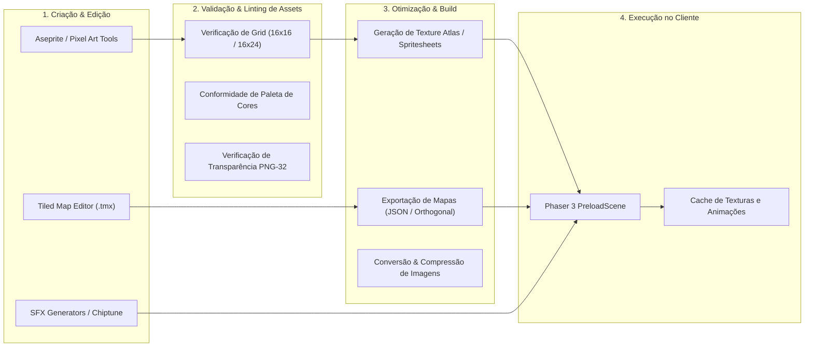

# Pipeline de Produção e Otimização de Assets — NoobRPG

## 1. Visão Geral do Pipeline de Assets
O pipeline de assets garante que todos os recursos gráficos, sonoros e mapas sejam consistentes com a direção de arte em pixel art, formatados corretamente para o motor Phaser 3 e carregados com alta performance no navegador.

---

## 2. Padrões Técnicos de Assets Gráficos

### 2.1 Formato de Imagem e Metadados
- **Formato:** PNG com canal Alfa de 32 bits (RGB + Transparência total sem anti-aliasing borrado).
- **Alinhamento e Dimensões:**
  - Tilesets: Múltiplos estritos de `16` pixels (ex: `256 × 256`, `512 × 512`), sem margens ou espaçamentos adicionais entre tiles (`margin: 0`, `spacing: 0`).
  - Spritesheets de Personagens: Dimensões uniformes por quadro (`frameWidth: 16`, `frameHeight: 24` ou `frameWidth: 24`, `frameHeight: 32`).
- **Ponto de Origem e Caixa de Colisão:**
  - Origem gráfica padrão: Pé do personagem (`originX: 0.5`, `originY: 0.85`).
  - Caixa de colisão física (Arcade / Server Grid): `width: 12`, `height: 10`, posicionada na base dos pés, permitindo que a cabeça do personagem sobreponha copas de árvores e paredes altas (*Y-sorting depth* natural).

---

## 3. Mapas no Tiled Map Editor

### 3.1 Configuração de Camadas no Tiled
Para cada mapa exportado em formato JSON ortogonal, as camadas devem seguir a nomenclatura padronizada:
1. `Ground_Base`: Grama, terra, pisos de pedra (sem colisão).
2. `Ground_Deco`: Flores, pedrinhas, caminhos de terra, tapetes (sem colisão).
3. `Collision_Walls`: Paredes, rochas, água intransponível (camada com propriedade de colisão `collides: true` lida pelo servidor e pelo cliente).
4. `Objects_Y_Sort`: Árvores, postes, barris, pilares (renderizados com ordenação dinâmica de profundidade baseada na coordenada Y).
5. `Spawners_Objects`: Camada de objetos vetoriais com marcações de pontos de spawn de monstros, NPCs, pontos de entrada de teleporte e nós de recursos.
6. `Overhead_Roof`: Copas de árvores e telhados que cobrem o personagem quando ele passa por baixo (renderizados acima do jogador).

---

## 4. Pipeline de Áudio
- **SFX (Efeitos Sonoros):**
  - Formato: WAV compactado ou MP3/OGG estéreo leve (amostragem 44.1 kHz, 16 bits).
  - Duração máxima: 0.2 a 1.5 segundos.
  - Baixa latência com decodificação no carregamento inicial (`scene.load.audio(...)`).
- **BGM (Música de Fundo):**
  - Loop contínuo com crossfade suave de 1.5s entre regiões.
  - Streaming assíncrono para não travar a inicialização do jogo.

---

## 5. Scripts Automatizados de Processamento de Assets
No repositório, criaremos utilitários em Node.js (`scripts/process-assets.js`) para:
1. Validar se todos os arquivos referenciados no código existem em disco.
2. Gerar automaticamente arquivos de índice TypeScript com mapeamento de tipos fortes para todas as chaves de textura e áudio (`AssetKeys.ts`), eliminando erros de digitação em tempo de desenvolvimento.
