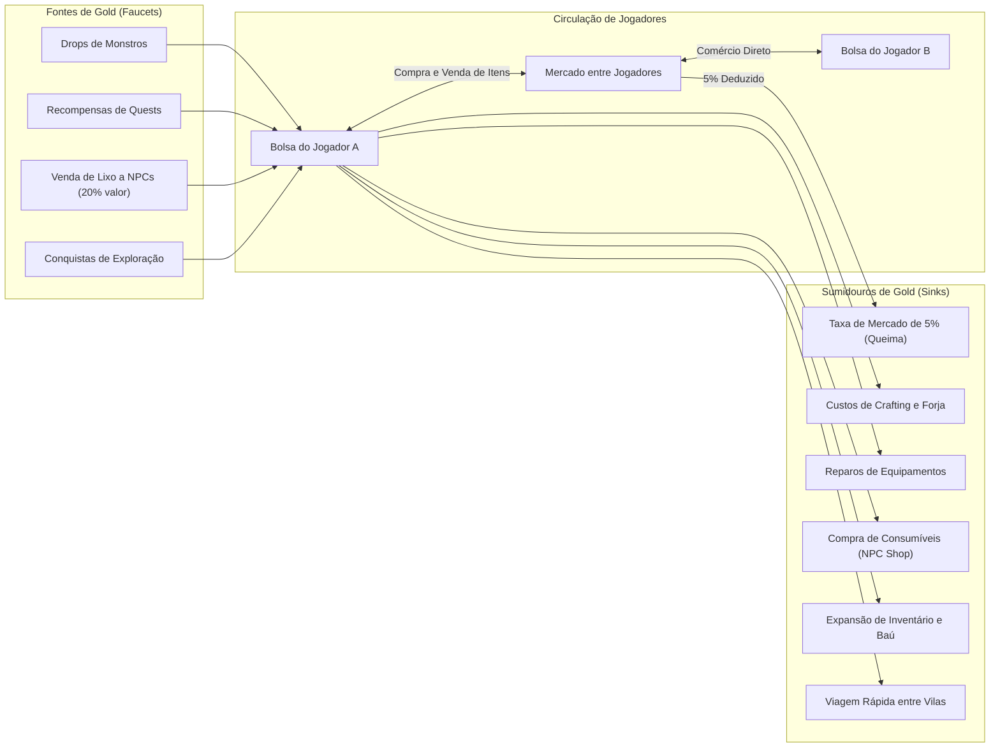

# Economia, Mercado e Tokenomics — NoobRPG

## 1. Princípios da Economia de Duas Moedas

A estabilidade econômica é fundamental para a longevidade do NoobRPG. O sistema separa rigorosamente:
1. **Gold:** Moeda corrente de gameplay, obtida e gasta ativamente dentro do ecossistema do jogo.
2. **Pontos de Mérito (Merit Points):** Moeda intransferível e não-negociável vinculada à conta, servindo como modelo de teste e abstração de recompensas para a futura integração de tokens/blockchain (Fase 8).

> [!IMPORTANT]
> **Fase 1 a 7:** Nenhuma blockchain, criptomoeda ou NFT real será criada ou transacionada. Todo o fluxo é simulado e auditado internamente no banco de dados com integridade ACID estrita.

---

## 2. A Economia de Gold: Fontes (Faucets) e Sumidouros (Sinks)

Para combater a hiperinflação comum em MMORPGs, a emissão diária de Gold deve ser rigorosamente balanceada com sumidouros obrigatórios e contínuos.

### 2.1 Modelagem Numérica Diária por Jogador Ativo (Estimativa)
- **Geração Média Diária (1h a 2h de gameplay):** ~ $1.200$ a $2.500$ Gold.
- **Drenagem Média Diária por Sumidouros:**
  - Reparos de equipamentos e poções: ~ $400$ a $700$ Gold.
  - Taxas de crafting / aprimoramento: ~ $500$ a $1.000$ Gold.
  - Taxas de mercado (5% sobre volume transacionado): ~ $300$ a $800$ Gold.
- **Taxa de Retenção Líquida Alvo:** $+15\%$ a $+20\%$ ao dia no início, estabilizando-se em platô conforme o jogador atinge equipamentos endgame que exigem taxas de manutenção proporcionalmente maiores.

---

## 3. Loja Oficial (NPC Vendors) vs. Mercado entre Jogadores

### 3.1 Loja Oficial do Sistema (NPC Shop)
- Controlada pelo motor do jogo.
- **Catálogo de Venda aos Jogadores:**
  - Poções básicas de Cura e Mana.
  - Equipamentos de nível inicial (Nível 1 a 3).
  - Ferramentas de coleta básicas (Picareta de Cobre, Machado de Madeira).
  - Receitas e manuais de crafting.
- **Preço de Recompra de Itens do Jogador:**
  - O NPC compra itens e materiais do jogador por **$20\%$ do valor base tabelado**. Isso assegura um valor mínimo de liquidez para lixo de monstros (*trash loot*) sem criar jatos incontroláveis de Gold.

### 3.2 Mercado entre Jogadores (Player Marketplace)
- **Regra de Transação:**
  - O jogador vendedor lista um item elegível com preço fixo em Gold.
  - O item é **removido imediatamente** do inventário do jogador e movido para a custódia do mercado (`escrow`).
  - **Taxa Obrigatória:** **$5\%$** do valor final da venda é destruído permanentemente da economia.
    $$\text{Gold Recebido pelo Vendedor} = \lfloor \text{Preço de Venda} \times 0.95 \rfloor$$
    $$\text{Taxa Queimada pelo Sistema} = \lceil \text{Preço de Venda} \times 0.05 \rceil$$
- **Prazo de Expiração:** Ofertas ativas expiram após **48 horas**. Se não vendidas, o item retorna automaticamente ao armazém/correio do jogador sem cobrança de taxa de listagem.
- **Prevenção de Explorações e Concorrência:**
  - Transações executadas com `SELECT FOR UPDATE` no PostgreSQL e isolamento `SERIALIZABLE`.
  - Impossibilidade física de compra concorrente duplicada do mesmo item.
  - Limite de até 10 ofertas ativas simultâneas por jogador (evita spam e monopolização).

---

## 4. Estratégia de Abstração de Recompensas e Tokenomics Futura

### 4.1 Pontos de Mérito (Merit Points)
- **Natureza:** Moeda de reputação intransferível, não-negociável e vinculada à conta.
- **Origem:** Conclusão de masmorras difíceis, primeiras derrotas de bosses da semana, missões de caça diárias e eventos comunitários.
- **Utilidade na Fase de Testes:**
  - Troca por títulos cosméticos, cores especiais de vestimenta, skins de armas e baús cosméticos fechados.
  - Validação de regras de teto de emissão semanal (Weekly Emission Cap).

### 4.2 Arquitetura de Tokenomics Teórica (Para Fase 8)
- **Sem Promessas Financeiras:** O jogo é desenhado primeiro como entretenimento e desafio. Nenhum retorno financeiro é prometido.
- **Orçamento de Emissão Fechado (Fixed Pool Distribution):** Recompensas de token são distribuídas a partir de uma reserva finita baseada na proporção de Mérito acumulado no período por jogadores verificados, impedindo criação inflacionária descontrolada.
- **Mecanismos Anti-Sybil e Anti-Bot:**
  - Requisito de tempo de jogo mínimo, nível de personagem e histórico de atividades para elegibilidade a recompensas de temporada.
  - Auditoria automatizada de heurística de inputs de combate e movimentação para banir instâncias automatizadas.
