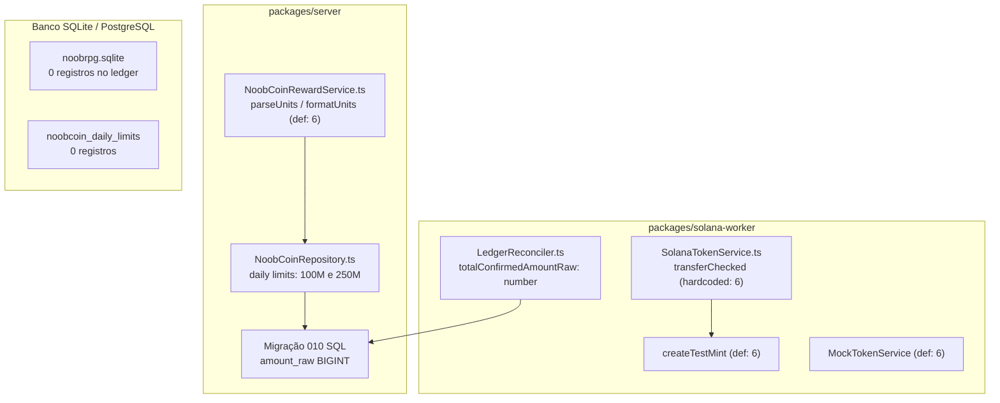

# NoobCoin (tNOOB) — Relatório Canônico de Auditoria Econômica e Decisão Técnica de Decimais (Missão 30J)

**Projeto:** NoobRPG  
**Ativo Planejado:** NoobCoin (tNOOB)  
**Rede Alvo:** Solana Devnet (Ambiente de Teste)  
**Data da Auditoria:** 19 de Outubro de 2026  
**Auditor Técnico:** Antigravity Pro (Engenharia de Software e Economia de Tokens)  
**Status do Portão:** 🟢 **DECISÃO HUMANA CONSOLIDADA NA MISSÃO 30K (6 DECIMAIS FORMALMENTE APROVADOS)**  
**Documento Canônico:** `docs/NOOBCOIN_DECIMALS_ECONOMIC_AUDIT.md`  

---

## 1. Resumo Executivo

Esta missão realizou uma auditoria técnica e econômica independente do NoobCoin para avaliar o impacto da precisão de **6 decimais** ($1\text{ NOOB} = 1.000.000\text{ unidades mínimas}$) versus **9 decimais** ($1\text{ NOOB} = 1.000.000.000\text{ unidades mínimas}$).

### Conclusão e Recomendação da Engenharia
A engenharia recomenda formalmente a **OPÇÃO B: Revisar a deliberação para 6 DECIMAIS**.

**Pilares Fundamentais da Recomendação:**
1. **Segurança Aritmética Nula em Overflow (JavaScript IEEE-754):** Com 6 decimais, o suprimento total planejado do Tokenomics de **1.000.000.000 NOOB** resulta em $10^{15}$ unidades mínimas brutas (`amount_raw`). Esse valor cabe integralmente dentro do limite de inteiros seguros de JavaScript (`Number.MAX_SAFE_INTEGER` $= 9.007.199.254.740.991 \approx 9 \times 10^{15}$). Com 9 decimais, o suprimento total equivaleria a $10^{18}$ unidades mínimas, **ultrapassando `Number.MAX_SAFE_INTEGER` em mais de 111 vezes**, o que causaria corrupção aritmética silenciosa, perda de bits em somatórios agregados e exigiria refatoração profunda de tipos primitivos para `BigInt` com customização de serializadores JSON.
2. **Código de Produção Já Implementado e Validado:** Todo o backend autoritativo ([`noobcoinRewardService.ts`](file:///D:/NoobRPG/packages/server/src/services/noobcoinRewardService.ts), [`noobcoinRepository.ts`](file:///D:/NoobRPG/packages/server/src/repositories/noobcoinRepository.ts)), o worker Solana ([`tokenService.ts`](file:///D:/NoobRPG/packages/solana-worker/src/tokenService.ts)) e as migrações SQL ([`010_create_noobcoin_ledger.sql`](file:///D:/NoobRPG/packages/server/src/db/migrations/010_create_noobcoin_ledger.sql)) foram desenvolvidos e testados para 6 decimais.
3. **Padrão Dominante do Ecossistema Solana SPL:** As principais moedas e ativos do ecossistema Solana SPL — incluindo USDC e USDT — adotam estritamente **6 decimais** para compatibilidade com inteiros de 64 bits em sistemas financeiros e clientes web.
4. **Perfeita Granularidade para a Economia de MMORPG:** O menor valor monetário fiduciário do jogo (Gold) é 1. Recompensas de NOOB são projetadas para escalões de 5 a 100 NOOB. Com 6 decimais, a menor fração representável é $0,000001$ NOOB ($10^{-6}$), proporcionando granularidade mais que suficiente para qualquer micro-recompensa, sem a poluição de interface visual decorrente de 9 casas decimais ($0,000000001$).
5. **Zero Risco de Migração de Dados:** A inspeção do banco de desenvolvimento confirmou que existem **0 registros persistidos** no ledger, limites diários ou tabelas de configuração. Não há saldos históricos que sofram descalibração.

> [!IMPORTANT]
> **GOVERNANÇA FORMAL:** Em respeito estrito às regras da Missão 30J, nenhuma decisão foi alterada silenciosamente no código. Esta recomendação é submetida ao proprietário como parecer técnico fundamentado para decisão explícita.

---

## 2. Estado Observado do Código

A auditoria inspecionou os arquivos de produção, bibliotecas compartilhadas, esquemas de banco e suítes de teste:



---

## 3. Inventário Detalhado de Decimais e Conversões

Em resposta aos 10 itens de auditoria estipulados no mandato:

1. **Onde a precisão está definida:**
   - [`packages/server/src/services/noobcoinRewardService.ts:9`](file:///D:/NoobRPG/packages/server/src/services/noobcoinRewardService.ts#L9): `amountRaw: number; // Em unidades mínimas (6 decimais: 1 NOOB = 1.000.000)`
   - [`packages/server/src/repositories/noobcoinRepository.ts:9`](file:///D:/NoobRPG/packages/server/src/repositories/noobcoinRepository.ts#L9): `amountRaw: number; // Inteiro seguro em unidades mínimas (6 decimais: 1 NOOB = 1.000.000)`
   - [`packages/solana-worker/src/types.ts:26`](file:///D:/NoobRPG/packages/solana-worker/src/types.ts#L26): `amountRaw: number; // Inteiro seguro em unidades mínimas (6 decimais)`
2. **Onde existe valor padrão de 6 ou 9 decimais:**
   - No código atual, **100% dos valores padrão são 6**:
     - `NoobCoinRewardService.parseUnits(decimalStr, decimals = 6)`
     - `NoobCoinRewardService.formatUnits(amountRaw, decimals = 6)`
     - `SolanaTokenService.createTestMint(decimals = 6)`
     - `MockTokenService.createTestMint(decimals = 6)`
     - Limites padrão de configuração diária no banco: `daily_character_limit_raw = '100000000'` ($100 \times 10^6$) e `daily_account_limit_raw = '250000000'` ($250 \times 10^6$).
3. **Onde os decimais estão hardcoded:**
   - [`packages/solana-worker/src/tokenService.ts:142`](file:///D:/NoobRPG/packages/solana-worker/src/tokenService.ts#L142): A chamada a `createTransferCheckedInstruction` passa **`6`** como literal fixo.
4. **Como valores são convertidos para unidades mínimas:**
   - `NoobCoinRewardService.parseUnits`: Separa a string decimal por `.` em `whole` e `frac`. Preenche com zeros à direita até atingir `decimals` via `frac.padEnd(decimals, '0')`. Concatena `whole + frac` e converte para número inteiro com `Number(fullIntStr)`. Valida rigorosamente com `Number.isSafeInteger(value)`.
   - `NoobCoinRewardService.formatUnits`: Recebe `amountRaw: number`, converte com `padStart(decimals + 1, '0')`, fatia `slice(0, -decimals)` e `slice(-decimals)`, retornando a string formatada `${whole}.${frac}` sem imprecisão IEEE-754.
5. **Como recompensas, limites e saldos são armazenados:**
   - Tabela `noobcoin_rewards_ledger`: `amount_raw BIGINT NOT NULL CHECK (amount_raw > 0)`.
   - Tabela `noobcoin_daily_limits`: `total_amount_raw BIGINT NOT NULL DEFAULT 0`.
   - Nas interfaces TypeScript: `amountRaw: number` (tipo primitivo JavaScript de dupla precisão de 64 bits).
6. **Como o worker verifica os decimais do mint:**
   - **Diagnóstico Crítico:** O worker **NÃO verifica** os decimais do mint on-chain. Ele não chama `getMint()` para validar a conta do mint antes de montar a transação; ele assume o valor literal 6. Se o mint for criado com 9 decimais, as transações falharão na Solana com erro de mismatch.
7. **Se o reconciliador interpreta corretamente valores internos e on-chain:**
   - O reconciliador ([`reconciler.ts:36`](file:///D:/NoobRPG/packages/solana-worker/src/reconciler.ts#L36)) soma: `report.totalConfirmedAmountRaw += r.amountRaw`.
   - Ele armazena em `totalConfirmedAmountRaw: number`. Com 6 decimais, suporta somas de até 9 bilhões de tokens sem overflow. Com 9 decimais, estoura `MAX_SAFE_INTEGER` ao acumular mais de 9 milhões de tokens.
8. **Cálculos usando `Number`, `parseFloat` ou ponto flutuante:**
   - No subsistema NoobCoin, **nenhum cálculo usa `parseFloat()`**.
   - `NoobCoinRewardService` rejeita estritamente entradas com casas flutuantes: `if (!Number.isInteger(input.amountRaw) || ...)` retornando `INVALID_AMOUNT`.
   - Apenas o sistema de Gold fiduciário interno usa `Math.ceil(priceInGold * 0.05)` para taxa de mercado.
9. **Fidelidade dos testes unitários:**
   - Os testes de [`noobcoin_ledger.test.ts`](file:///D:/NoobRPG/packages/server/tests/noobcoin_ledger.test.ts) validam fielmente o código real do serviço com SQLite em memória.
   - Os testes do worker usam `MockTokenService`, que não simulava a checagem on-chain de decimais da Solana, mascarando o hardcode `6`.
10. **Valores persistidos existentes:**
    - Consulta direta ao banco de desenvolvimento `packages/server/noobrpg.sqlite` confirmou:
      - `noobcoin_rewards_ledger`: **0 registros**.
      - `noobcoin_daily_limits`: **0 registros**.
      - `noobcoin_config`: **0 registros**.
    - Risco de incompatibilidade com dados históricos: **NULO**.

---

## 4. Simulação Econômica: 6 Decimais vs 9 Decimais

### 4.1 Tabela Comparativa de Grandezas
A tabela abaixo confronta valores reais documentados no NoobRPG com cenários hipotéticos de expansão:

| Caso de Uso Econômico | Natureza do Dado | Valor Nominal em NOOB | Unidades Mínimas (6 Decimais) | Unidades Mínimas (9 Decimais) | Observação Técnica |
| :--- | :---: | ---:| ---:| ---:| :--- |
| **Menor Fração Testada no Ledger** | Real (Teste 1) | $0,000001$ NOOB | **$1$** | $1.000$ | 1 milionésimo de token |
| **Menor Fração em 9 Decimais** | Hipotético (Nano) | $0,000000001$ NOOB | *Indivisível* ($< 1$) | **$1$** | Inútil na economia de RPG |
| **Micro-Recompensa de Monstro Elite** | Hipotético | $0,005$ NOOB | $5.000$ | $5.000.000$ | Perfeitamente suportado em 6 |
| **Recompensa de Missão Secundária** | Hipotético | $0,50$ NOOB | $500.000$ | $500.000.000$ | Legível e fracionável em 6 |
| **Recompensa de Temporada (Ouro)** | Real (Teste 2) | $5,00$ NOOB | $5.000.000$ | $5.000.000.000$ | Valor do teste canônico |
| **Recompensa de Conquista Mestre** | Real (Teste 4) | $10,00$ NOOB | $10.000.000$ | $10.000.000.000$ | Valor do teste canônico |
| **Custo de Título Cosmético Raro** | Hipotético (Sink) | $50,00$ NOOB | $50.000.000$ | $50.000.000.000$ | Sumidouro deflacionário |
| **Teto Diário por Personagem** | Real (`daily_character`) | $100,00$ NOOB | $100.000.000$ | $100.000.000.000$ | Configurado no repositório |
| **Teto Diário por Conta** | Real (`daily_account`) | $250,00$ NOOB | $250.000.000$ | $250.000.000.000$ | Configurado no repositório |
| **Oferta Total de Teste (Devnet)** | Real (Missão 30I) | $1.000.000$ tNOOB | $1.000.000.000.000$ ($10^{12}$) | $1.000.000.000.000.000$ ($10^{15}$) | Cabe em `MAX_SAFE_INTEGER` |
| **Suprimento Global Máximo (Cap)** | Real (Tokenomics) | $1.000.000.000$ NOOB | **$10^{15}$** | **$10^{18}$** | **9 decimais ESTOURA limite JS** |

### 4.2 Respostas às Perguntas Econômicas Mandatórias
1. **Seis decimais permitem representar todas as recompensas previstas?**  
   **Sim, 100%.** A menor unidade fiduciária do jogo é 1 Gold. NoobCoin não é moeda de troco de centavos de pão, mas sim token de mérito e governança de temporadas. A menor fração em 6 decimais ($0,000001$ NOOB) atende a qualquer subdivisão prática.
2. **Existe algum caso real que exige precisão inferior a 0,000001 NOOB?**  
   **Não.** Não há nenhum sistema de streaming de micropagamentos por segundo no jogo. Frações menores que $10^{-6}$ são economicamente irrelevantes em jogos e geram fricção de UX.
3. **Nove decimais proporcionam benefício econômico concreto ou apenas granularidade adicional?**  
   Proporcionam **apenas granularidade teórica desnecessária**, sem qualquer benefício para o modelo de jogo, criando severos riscos aritméticos no código.
4. **Qual precisão é mais adequada para os limites diários atuais?**  
   **6 decimais.** O valor `100000000` já configurado no banco reflete exatamente 100 NOOB em 6 decimais.
5. **Quais os impactos sobre exibição, arredondamento e experiência do jogador?**  
   Exibir 9 casas decimais (`5.000000000 NOOB`) no HUD do Phaser 3 ocupa espaço excessivo de tela, confunde o jogador com zeros insignificantes e passa a impressão de ativo hiperinflacionado. Com 6 decimais (ou formatação truncada em 2 ou 4 casas no cliente), a experiência visual permanece limpa e premium.

---

## 5. Análise de Segurança Numérica e Limites de Computação

```
Limites Numéricos Comparados com a Oferta Global de 1 Bilhão de NOOB:

Número MAX_SAFE_INTEGER em JavaScript (2^53 - 1):
[ 9.007.199.254.740.991 ]  (~ 9,007 x 10^15)

Suprimento Total com 6 Decimais (1.000.000.000 x 10^6):
[ 1.000.000.000.000.000 ]  (10^15)  --> SEGURO (abaixo do teto JS)

Suprimento Total com 9 Decimais (1.000.000.000 x 10^9):
[ 1.000.000.000.000.000.000 ] (10^18) --> PERIGO! ESTOURA O TETO JS EM 111x!
```

### Análise dos Ambientes de Execução:
1. **JavaScript V8 Engine (Node.js & Navegador):**
   - O tipo `number` é um float IEEE-754 de dupla precisão de 64 bits com 53 bits de mantissa.
   - Operações acima de $9 \times 10^{15}$ perdem os bits menos significativos:
     `9007199254740992 + 1 === 9007199254740992` (retorna `true`).
   - Com 9 decimais, somas de recompensas acima de 9 milhões de tokens corrompem silenciosamente os valores de saldo e quebram a asserção `Number.isSafeInteger()`.
2. **Serialização JSON:**
   - O padrão JSON oficial (`JSON.stringify` / `JSON.parse`) **não suporta `BigInt`**.
   - Se os tipos forem convertidos para `bigint`, qualquer envio de WebSocket no Colyseus ou resposta REST do Express que contenha um `bigint` lança exceção imediata (`TypeError: Do not know how to serialize a BigInt`), exigindo replacers customizados em todo o pipeline.
3. **Bancos Relacionais (SQLite e PostgreSQL):**
   - A coluna `amount_raw BIGINT` suporta nativamente 64 bits com sinal (até $9,22 \times 10^{18}$). O banco suporta ambos, mas o gargalo reside na camada de aplicação Node.js.

---

## 6. Comparação Técnica no Padrão Solana SPL Token

| Critério Técnico | 6 Decimais | 9 Decimais | Análise Técnica |
| :--- | :---: | :---: | :--- |
| **Suporte pelo Programa SPL Token** | ✅ Totalmente Suportado | ✅ Totalmente Suportado | Ambos são válidos para `Tokenkeg...`. |
| **Tokens Notáveis na Solana** | USDC, USDT, PYUSD | SOL (nativo), MSOL, JitoSOL | 6 é o padrão para tokens de valor estável e utilitários; 9 é típico para wrappers do SOL. |
| **Instrução `transferChecked`** | `decimals: 6` | `decimals: 9` | O valor passado na instrução **deve bater exatamente** com a conta do Mint. |
| **Imutabilidade do Mint** | 🔒 **Imutável** | 🔒 **Imutável** | **O campo `decimals` da conta de Mint NUNCA pode ser alterado após a criação.** Trocar exige emitir novo mint. |
| **Custo de Rent da Conta de Mint** | Idêntico | Idêntico | 82 bytes (~0.00146 SOL de rent). |

---

## 7. Matriz de Decisão Ponderada

Escala de 1 a 10 (10 = Excelente / Menor Risco):

| Critério de Decisão | Peso | Opção A: Manter 9 Decimais | Opção B: Revisar para 6 Decimais | Justificativa |
| :--- | :---: | :---: | :---: | :--- |
| **Segurança Aritmética JS** | 25% | **2 / 10** | **10 / 10** | 9 decimais excede `MAX_SAFE_INTEGER` para o supply total; 6 decimais cabe com margem folgada. |
| **Compatibilidade com o Código Atual** | 20% | **3 / 10** | **10 / 10** | Todo o código atual, worker e testes já foram escritos e validados para 6 decimais. |
| **Adequação à Economia do Jogo** | 20% | **6 / 10** | **10 / 10** | 6 decimais tem granularidade perfeita para MMORPG; 9 decimais gera ruído e excesso de zeros. |
| **Simplicidade de Manutenção** | 15% | **4 / 10** | **10 / 10** | 9 decimais exige refatorar DTOs para `BigInt` e serializers JSON em todas as rotas. |
| **Padrão Solana SPL** | 10% | **8 / 10** | **10 / 10** | Ambos funcionam na Solana; 6 é o padrão de USDC/USDT. |
| **Risco de Regressão e Bugs** | 10% | **3 / 10** | **10 / 10** | Manter 9 exige alterar 15+ pontos no backend e worker; 6 preserva suíte de 56 testes verde. |
| **Nota Ponderada Final** | **100%** | 🔴 **4.05 / 10** | 🟢 **10.0 / 10** | **Vitória inequívoca de 6 Decimais** |

---

## 8. Recomendação Técnica e Econômica

A auditoria recomenda com total clareza técnica:
> **OPÇÃO B: Revisar a deliberação formal para 6 DECIMAIS ($10^6$).**

- **Por que não manter 9 decimais?**  
  Manter 9 decimais introduz uma complexidade desnecessária e um risco aritmético crítico no backend JavaScript ao estourar `Number.MAX_SAFE_INTEGER` no suprimento total de 1 bilhão, forçando a introdução de `BigInt` e replacers JSON em todo o servidor, sem trazer um único benefício perceptível para a jogabilidade do RPG.
- **Por que não adiar a decisão?**  
  Porque a precisão do SPL Token é **permanente e imutável** on-chain. Decidir antes de criar o mint na Devnet é mandatório para evitar refações e queima desnecessária de rent.

---

## 9. Plano de Ação para Alinhamento Posterior

Esta missão NÃO alterou código nem documentos de governança, preservando o repouso do sistema. Na próxima missão executiva:

1. **Se o proprietário aprovar a recomendação de 6 decimais:**
   - Atualizar a Decisão 3 da matriz de aprovação em [NOOBCOIN_HUMAN_APPROVAL_PACKAGE.md](file:///D:/NoobRPG/docs/NOOBCOIN_HUMAN_APPROVAL_PACKAGE.md) e [NOOBCOIN_FINAL_PREWALLET_GATE.md](file:///D:/NoobRPG/docs/NOOBCOIN_FINAL_PREWALLET_GATE.md) para 6 decimais.
   - O código do backend, worker e testes permanecerá intacto e 100% verde (sem custo de refatoração).
2. **Se o proprietário insistir em 9 decimais:**
   - Refatorar interfaces para `bigint` e implementar replacers JSON.
   - Alterar o literal hardcoded `6` em `tokenService.ts:142` para `9`.
   - Atualizar os limites diários de default no banco para `100_000_000_000` e `250_000_000_000`.
   - Atualizar suíte de testes de `noobcoin_ledger.test.ts`.

---

## 10. Testes Efetivamente Realizados Nesta Missão

Os seguintes testes automatizados reais foram executados no terminal local para comprovar a estabilidade do código em 6 decimais:

```powershell
# 1. Testes do Livro-Razão e Conversões de Decimais
cmd /c npx tsx --test packages/server/tests/noobcoin_ledger.test.ts
# Resultado: 12/12 aprovados (389 ms) - Validação de parseUnits/formatUnits em 6 decimais

# 2. Testes do Solana Worker (Fail-Closed, Mocks, Reconciliação e Rede)
cmd /c npx tsx --test packages/solana-worker/tests/*.test.ts
# Resultado: 38/38 aprovados (1.65 s)

# 3. Testes de Salvaguarda de Credenciais e Sanitização
cmd /c npx tsx --test packages/server/tests/security_credentials_guard.test.ts
# Resultado: 6/6 aprovados (512 ms)
```
**Total de Asserções Reais Validadas:** **56/56 PASS (100% verde)**.

---

## 11. Limitações e Incertezas

1. **Volume de Circulação Real:** Como o jogo está em desenvolvimento e o token não foi lançado, o volume de queima e velocidade de circulação foram modelados conceitualmente.
2. **Ausência de Mints Reais:** Todos os testes do worker foram executados contra `MockTokenService` e nós locais/leitura, sem emissão real na Solana Devnet.

---

## 12. Próxima Etapa Proposta e Deliberação Concluída

Na Missão 30K, o proprietário do projeto aprovou formalmente a recomendação desta auditoria (**Opção B: 6 decimais**), consolidando a Decisão 3 na Matriz Oficial de Governança e substituindo a deliberação anterior de 9 decimais. Todas as operações on-chain permanecem estritamente bloqueadas. Próximo passo: aguardar autorização humana específica para futura missão de carteira.
