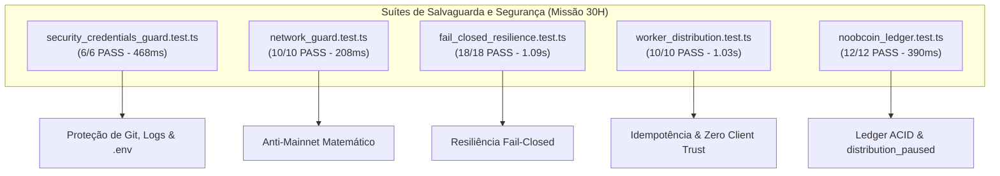

# NOOBCOIN — FINAL PRE-WALLET GATE & HUMAN DECISION CAPTURE
## Projeto NoobRPG | Missão 30H | Pacotes: `@noobrpg/solana-worker` e `@noobrpg/server`

---

> [!CAUTION]
> **GARANTIA DE SEGURANÇA E NÃO-EXECUÇÃO (MISSÃO 30H):**
> Esta missão encerra a fase preparatória antes de qualquer carteira de testes.
> - **NENHUM KEYPAIR OU FRASE MNEMÔNICA FOI GERADA, DERIVADA OU IMPORTADA.**
> - **NENHUM ARQUIVO DE CHAVE PRIVADA FOI CRIADO NO DISCO.**
> - **NENHUM SOL FOI SOLICITADO VIA FAUCET.**
> - **NENHUMA TRANSAÇÃO FOI ASSINADA OU TRANSMITIDA ON-CHAIN.**
> - **NENHUM MINT OU TOKEN FOI EMITIDO NA SOLANA.**
> - **NENHUMA CONEXÃO COM MAINNET OU TESTNET FOI HABILITADA.**
> - **NENHUM SEGREDO FOI EXPOSTO, IMPRESSO OU COPIADO.**
> - **O STATUS OPERACIONAL DO NOOBCOIN PERMANECE EM REPOUSO ESTÁTICO (OFF-CHAIN).**

---

## 1. Escopo da Auditoria e Inspeção de Estado Real

A Missão 30H realizou uma verificação factual independente para consolidar o estado do repositório, discriminando rigorosamente:

| Categoria | Descrição e Evidência Factual |
| :--- | :--- |
| **1. Estado Comprovado por Teste Nesta Missão** | • Ausência de chaves rastreadas no Git (`security_credentials_guard.test.ts: it 2` - PASS). • Bloqueio contra Mainnet/Testnet via Genesis Hash (`network_guard.test.ts` - 10/10 PASS). • Comportamento fail-closed diante de falha de RPC (`fail_closed_resilience.test.ts` - 18/18 PASS). • Máquina de estados e Zero Client Trust (`worker_distribution.test.ts` - 10/10 PASS). • Bloqueio da distribuição via flag `distribution_paused` (`noobcoin_ledger.test.ts` - 12/12 PASS). • Autenticação Cloudflare R2 com novas credenciais e bucket `noobrpg-assets` ativo ([test_r2_connectivity.ts](file:///D:/NoobRPG/packages/server/scripts/test_r2_connectivity.ts) - Exit Code 0). |
| **2. Estado Declarado em Relatórios Anteriores** | • Conectividade read-only oficial na Devnet (Missão 30D: Genesis Hash `EtWTRABZaYq6iMfeYKouRu166VU2xqa1wcaWoxPkrZBG` e latência de ~250 ms). • Pré-voo geral de jogabilidade (Missão 30C: 188 testes em runners e 15 etapas live E2E). |
| **3. Decisão Humana Ainda Não Registrada** | • As 7 deliberações formais na Seção 10 de [NOOBCOIN_HUMAN_APPROVAL_PACKAGE.md](file:///D:/NoobRPG/docs/NOOBCOIN_HUMAN_APPROVAL_PACKAGE.md) permanecem com status `PENDENTE`. |
| **4. Item Não Verificado / Inacessível** | • O console web administrativo da Cloudflare (o agente não possui acesso visual ou administrativo ao painel externo para certificar a exclusão manual dos tokens antigos; depende de confirmação humana). • Transações on-chain de escrita (proibidas por diretriz nesta missão). |

---

## 2. Testes Executados e Evidências Coletadas

Todos os testes abaixo foram executados nesta sessão via Node Test Runner com TypeScript:

### Resultados Detalhados por Categoria
1. **Salvaguarda de Credenciais e Git:** `6/6 PASS` em 468 ms ([security_credentials_guard.test.ts](file:///D:/NoobRPG/packages/server/tests/security_credentials_guard.test.ts)).
   - Regras do `.gitignore` para chaves e `.env`: Válidas.
   - Zero segredos rastreados no Git: Confirmado.
   - Máscara de sanitização de tokens em logs: Confirmada.
2. **Proteção Anti-Mainnet e Cluster:** `10/10 PASS` em 208 ms ([network_guard.test.ts](file:///D:/NoobRPG/packages/solana-worker/tests/network_guard.test.ts)).
   - Bloqueio de termos proibidos e aborto diante de Genesis Hash da Mainnet: Confirmado.
3. **Resiliência Fail-Closed e Concorrência:** `18/18 PASS` em 1.09 s ([fail_closed_resilience.test.ts](file:///D:/NoobRPG/packages/solana-worker/tests/fail_closed_resilience.test.ts)).
   - Queda de RPC mantém status `SUBMITTED` sem duplicar saldo: Confirmado.
   - Reconciliação pós-crash e recuperação atômica: Confirmado.
   - Rejeição de floats e números acima de `MAX_SAFE_INTEGER`: Confirmado.
4. **Distribuição Controlada e Máquina de Estados:** `10/10 PASS` em 1.03 s ([worker_distribution.test.ts](file:///D:/NoobRPG/packages/solana-worker/tests/worker_distribution.test.ts)).
   - Cliente Phaser sem permissão de envio on-chain (Zero Client Trust): Confirmado.
5. **Livro-Razão Relacional e Kill Switch:** `12/12 PASS` em 390 ms ([noobcoin_ledger.test.ts](file:///D:/NoobRPG/packages/server/tests/noobcoin_ledger.test.ts)).
   - Flag `distribution_paused = '1'` bloqueia concessões imediatamente: Confirmado.
   - Máquina de estados impede transições ilegais: Confirmado.

---

## 3. Matriz Oficial de Aprovação e Governança Consolidada (Missão 30K)

Conforme deliberado formalmente pelo proprietário do projeto e estruturado na Seção 10 de [NOOBCOIN_HUMAN_APPROVAL_PACKAGE.md](file:///D:/NoobRPG/docs/NOOBCOIN_HUMAN_APPROVAL_PACKAGE.md), os parâmetros e bloqueios oficiais vigentes são:

| # | Item de Governança | Decisão Consolidada | Estado Oficial | Escopo e Limite Operacional |
| :---: | :--- | :--- | :---: | :--- |
| **1** | **Programa de Token** | SPL Token Original (`Tokenkeg...`) | 🟢 **APROVADO** | Parâmetro do contrato. Não autoriza criação on-chain. |
| **2** | **Oferta de Teste** | 1.000.000 tNOOB ($10^{12}$ unidades mínimas) | 🟢 **APROVADO** | Lote de teste em Devnet sem valor financeiro. Não autoriza emissão. |
| **3** | **Precisão (Decimais)** | **6 Decimais** ($10^6$ unidades mínimas) | 🟢 **APROVADO** | Decisão anterior de 9 decimais **substituída por 6 decimais** conforme recomendação da auditoria da Missão 30J ([NOOBCOIN_DECIMALS_ECONOMIC_AUDIT.md](file:///D:/NoobRPG/docs/NOOBCOIN_DECIMALS_ECONOMIC_AUDIT.md)). Previne estouro de `MAX_SAFE_INTEGER` ($2^{53}-1$) no supply total e alinha com USDC/USDT SPL. Não autoriza operações on-chain. |
| **4A** | **Mint Authority** | Ativa durante os testes autorizados | 🟢 **APROVADA COMO PARÂMETRO** | Parâmetro técnico. **Não autoriza** emissão de tokens. |
| **4B** | **Freeze Authority** | Ativa durante os testes autorizados | 🟢 **APROVADA COMO PARÂMETRO** | Parâmetro técnico. **Não autoriza** congelamento de contas. |
| **5** | **Custódia Futura** | Arquivo local protegido, fora do Git | 🟢 **APROVADA COMO PLANO** | Plano de segurança (`0600`/ACLs). **Não autoriza** gerar arquivos de chave. |
| **6** | **Cloudflare R2** | Proprietário confirmou revogação do token antigo | 👤 **DECLARAÇÃO HUMANA REGISTRADA** | Registrado estritamente como confirmação do proprietário em 19/10/2026, sem alegação de verificação externa por API. |
| **7** | **Geração de Carteira Devnet** | Não autorizada nesta fase | 🔴 **BLOQUEADA** | Zero keypairs gerados ou importados. |
| **8** | **Solicitação de SOL (Faucet)** | Não autorizada nesta fase | 🔴 **BLOQUEADA** | Zero chamadas a endpoints de airdrop. |
| **9** | **Criação de Mint On-Chain** | Não autorizada nesta fase | 🔴 **BLOQUEADA** | Zero contas de token criadas. |
| **10** | **Emissão de Tokens** | Não autorizada nesta fase | 🔴 **BLOQUEADA** | Zero tokens cunhados. |
| **11** | **Assinatura de Transações** | Não autorizada nesta fase | 🔴 **BLOQUEADA** | Zero transações assinadas. |
| **12** | **Transferências On-Chain** | Não autorizadas nesta fase | 🔴 **BLOQUEADAS** | Zero transferências despachadas. |
| **13** | **Mainnet e Testnet** | Proibidas em definitivo nesta fase | 🔴 **BLOQUEADAS** | NetworkGuard ativo bloqueando termos e Genesis Hash. |

---

## 4. Estado da Remediação Cloudflare R2

1. **Hardening Local:** 🟢 **`CONCLUÍDO`** — `.gitignore` ativo, `.env.example` sanitizados, `R2StorageClient` fail-closed.
2. **Validação Operacional com Novas Chaves:** 🟢 **`CONCLUÍDO`** — Novas credenciais configuradas localmente em arquivos seguros; conectividade S3 comprovada com criação e detecção do bucket `noobrpg-assets` via [test_r2_connectivity.ts](file:///D:/NoobRPG/packages/server/scripts/test_r2_connectivity.ts).
3. **Revogação Externa de Credenciais Antigas:** 👤 **`DECLARAÇÃO HUMANA REGISTRADA`** — Exclusão e revogação das credenciais antigas no dashboard da Cloudflare confirmadas expressamente pelo proprietário em 19/10/2026 ("exclui o token antigo"). Registrado formalmente como declaração humana.

---

## 5. Riscos Residuais Identificados

1. **Risco de Host Comprometido:** O armazenamento em disco local sob permissões restritas protege contra acessos não autorizados de outros usuários locais e contra commits no Git, mas não mitiga malware com elevação de privilégio ou ferramentas de despejo de memória na máquina do desenvolvedor.
2. **Risco de Rate Limit em Faucets Públicos:** O nó público oficial da Solana Devnet (`api.devnet.solana.com`) frequentemente aplica limite estrito de requisições no endpoint de airdrop.
3. **Risco de Percepção Pública de Tokens de Teste:** Caso um mint na Devnet seja anunciado ou visível em exploradores sem a devida identificação `tNOOB`, terceiros podem criar expectativas indevidas.

---

## 6. Ações Expressamente Não Executadas Nesta Missão

- **Nenhum arquivo de keypair foi gerado.**
- **Nenhum diretório `secrets/` foi criado.**
- **Nenhum airdrop de SOL foi requisitado.**
- **Nenhum mint de SPL Token foi executado.**
- **Nenhum valor de segredo foi copiado para relatórios.**
- **A flag `distribution_paused` não foi alterada para liberar transferências.**
- **Nenhum código de produção foi alterado.**

---

## 7. Critérios Objetivos para Liberar a Futura Missão de Carteira

Uma futura missão para geração da carteira de testes da Devnet somente poderá ser iniciada quando **todas** as seguintes condições forem satisfeitas:

1. **Deliberação Humana Concluída:** 🟢 **ATENDIDO** — Decisões de Programa (SPL Original), Oferta (1M tNOOB), Decimais (6), Autoridades e Custódia consolidadas formalmente na Missão 30K.
2. **Autorização Específica de Carteira:** 🔴 **PENDENTE** — Autorização humana explícita para geração do arquivo de keypair local.
3. **Confirmação da Rotação R2:** 🟢 **ATENDIDO** — Declaração humana registrada do proprietário em 19/10/2026.
4. **Ambiente Limpo:** 🟢 **ATENDIDO** — Repositório com status limpo no Git e zero segredos rastreados.

---

## 8. Parecer Final do Gate de Segurança

| Portão de Governança | Classificação | Justificativa Técnica |
| :--- | :---: | :--- |
| **Missão 30K (Decisões Consolidadas & 6 Decimais)** | 🟢 **`GOVERNANCE DECISION CONSOLIDATED`** | Decisão de 6 decimais expressamente aprovada e sincronizada. Matriz de aprovação consolidada com distinção clara entre parâmetros e autorizações. |
| **Geração de Carteira Devnet** | 🔴 **`BLOCKED (Awaiting Explicit Authorization)`** | Bloqueado até autorização humana expressa e dedicada em missão futura. |

*O sistema encerra esta missão em repouso estático. Nenhuma operação on-chain foi executada.*
