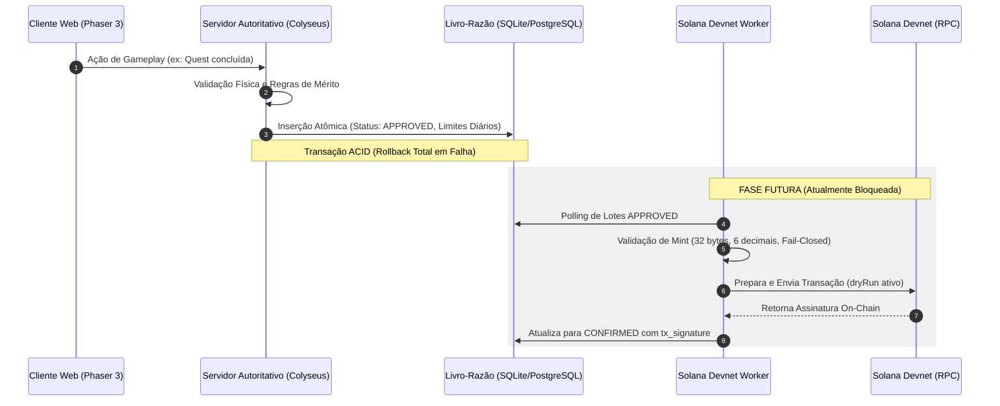

# NOOBCOIN (NOOB) — DOSSIÊ DE GOVERNANÇA TÉCNICA E OPERACIONAL
## Projeto NoobRPG | Missão 30Q | Documento Canônico de Governança

---

> [!CAUTION]
> **GARANTIA INVIOLÁVEL DE SEGURANÇA E NÃO-EXECUÇÃO ON-CHAIN:**
> Este dossiê é estritamente documental e tem como objetivo consolidar as decisões humanas, arquitetura técnica e evidências de auditoria do NoobCoin.
> - **NENHUMA CARTEIRA FOI GERADA, DERIVADA OU IMPORTADA.**
> - **NENHUM ARQUIVO DE CHAVE PRIVADA (KEYPAIR) FOI CRIADO NO DISCO.**
> - **NENHUM SOL FOI SOLICITADO VIA FAUCET OU AIRDROP.**
> - **NENHUM MINT OU TOKEN FOI CRIADO OU CUNHADO NA BLOCKCHAIN.**
> - **NENHUMA TRANSAÇÃO FOI ASSINADA OU TRANSMITIDA ON-CHAIN.**
> - **A DISTRIBUIÇÃO PERMANECE PAUSADA (`distribution_paused = '1'`).**
> - **MAINNET E TESTNET PERMANECEM MATEMATICAMENTE BLOQUEADAS.**
> - **A APROVAÇÃO DE PARÂMETROS NÃO CONSTITUI AUTORIZAÇÃO PARA OPERAÇÕES ON-CHAIN.**

---

## 1. Resumo Executivo e Status Atual

O **NoobCoin (NOOB)** é o token utilitário de governança e mérito planejado para o ecossistema do MMORPG **NoobRPG**. O projeto encontra-se em estágio de desenvolvimento pré-on-chain, com toda a lógica contábil, controles defensivos, infraestrutura de simulação autoritativa e resiliência de worker implementados e validados localmente.

### Status Geral do Projeto:
- **Estado Operacional:** Repouso estático off-chain.
- **Rede Planejada para Testes:** Solana Devnet exclusivamente.
- **Programa Planejado:** Original SPL Token (`TokenkegQfeZyiNwAJbNbGKPFXCWuBvf9Ss623VQ5DA`).
- **Simulação em Tempo Real:** 20 Hz no servidor autoritativo desacoplada de operações blockchain.
- **Ledger Interno:** Livro-razão relacional ACID (`noobcoin_rewards_ledger`) com precisão de 6 decimais.
- **Pacote do Worker:** `@noobrpg/solana-worker` isolado, operando com NetworkGuard e validação fail-closed.
- **Status de Governança:** Documentação consolidada, com ratificação humana pendente. A criação de carteiras e todas as operações on-chain permanecem rigorosamente bloqueadas.

---

## 2. Decisões Humanas Aprovadas

As seguintes decisões foram formalmente deliberadas e aprovadas pelo proprietário do projeto (registradas originalmente em [NOOBCOIN_HUMAN_APPROVAL_PACKAGE.md](file:///D:/NoobRPG/docs/NOOBCOIN_HUMAN_APPROVAL_PACKAGE.md) e [NOOBCOIN_FINAL_PREWALLET_GATE.md](file:///D:/NoobRPG/docs/NOOBCOIN_FINAL_PREWALLET_GATE.md)):

| Parâmetro de Governança | Decisão Aprovada | Justificativa Técnica e de Segurança |
| :--- | :--- | :--- |
| **Nome do Token** | **NoobCoin** | Identidade do projeto. |
| **Símbolo do Ativo** | **NOOB** (prefixo `tNOOB` em visualizações de teste) | Explicita a finalidade de testes na Devnet. |
| **Blockchain Alvo** | **Solana** | Alta taxa de transferência, finalidade rápida (<1s) e baixas taxas de transação. |
| **Programa de Token** | **Original SPL Token** (`Tokenkeg...`) | Compatibilidade universal imediata com 100% dos exploradores e carteiras; maturidade de 4+ anos e código auditado sem complexidade de extensões. |
| **Precisão (Decimais)** | **6 Casas Decimais** ($10^6$ raw units por token) | Alinhado com a auditoria econômica da Missão 30J ([NOOBCOIN_DECIMALS_ECONOMIC_AUDIT.md](file:///D:/NoobRPG/docs/NOOBCOIN_DECIMALS_ECONOMIC_AUDIT.md)). Com seis decimais, o valor teórico de 1 bilhão de NOOB corresponde a $10^{15}$ unidades mínimas, valor inferior a `Number.MAX_SAFE_INTEGER` ($9.007.199.254.740.991$). Isso não garante que toda operação em JavaScript com valores financeiros seja inerentemente segura; cada operação de cálculo precisa preservar as invariantes de precisão e tipos numéricos apropriados. As conversões e validações existentes operam estritamente sobre inteiros seguros validados via `Number.isSafeInteger()`, `parseUnits` e `formatUnits`. |
| **Oferta de Teste Planejada** | **1.000.000 tNOOB** ($10^{12}$ raw units) | Lote controlado para testes funcionais e de concorrência. **Não autoriza emissão**. O teto teórico de 1 bilhão de NOOB também **não autoriza criação on-chain**. |
| **Mint Authority** | **Prevista como ativa durante testes futuros** | Condicionada à autorização operacional explícita e à criação autorizada do mint. Enquanto não existir mint criado, não há authorities desse mint ativas na blockchain. Permite emissão controlada de lotes adicionais em ambiente Devnet para testes de carga e estresse. Ciente de que a revogação on-chain é irreversível. |
| **Freeze Authority** | **Prevista como ativa durante testes futuros** | Condicionada à autorização operacional explícita e à criação autorizada do mint. Enquanto não existir mint criado, não há authorities desse mint ativas na blockchain. Permite simulação de contingência e contenção de exploits (circuit breaker) em contas de teste. Ciente de que a revogação on-chain é irreversível. |
| **Modelo de Custódia Futura** | **Arquivo local protegido e restrito** | Armazenamento planejado em `packages/solana-worker/secrets/devnet-payer-keypair.json` com permissões `0600`/ACLs, isolado do Git e restrito ao worker. |
| **Credenciais Antigas Cloudflare R2** | **Confirmação do Usuário de Exclusão** | O usuário informou ter revogado e excluído o token antigo no painel web Cloudflare em 19/10/2026. Registrado estritamente como confirmação do usuário (não como verificação técnica externa independente). |

---

## 3. Separação Obrigatória de Aprovações

Para evitar qualquer ambiguidade entre aprovação de especificações teóricas e autorizações de execução, a governança do NoobRPG segrega formalmente três categorias independentes:

```mermaid
graph LR
    subgraph CatA ["Categoria A: Parâmetros Aprovados"]
        A1["Nome: NoobCoin / NOOB"]
        A2["Decimais: 6"]
        A3["SPL Token Original"]
        A4["Oferta Teste: 1M tNOOB"]
        A5["Authorities: Previstas em Teste"]
    end

    subgraph CatB ["Categoria B: Preparação NÃO Autorizada"]
        B1["Geração de Keypair"]
        B2["Criação de Carteira"]
        B3["Solicitação de Faucet / SOL"]
        B4["Gravação de Chave em Disco"]
    end

    subgraph CatC ["Categoria C: Operações On-Chain NÃO Autorizadas"]
        C1["Criação de Mint Account"]
        C2["Cunhagem / Emissão de Tokens"]
        C3["Assinatura / Envio de Transações"]
        C4["Criação / Financiamento de ATAs"]
        C5["Ativação da Distribuição"]
    end

    CatA -.->|NÃO AUTORIZA| CatB
    CatB -.->|NÃO AUTORIZA| CatC
```



### Categoria A: Parâmetros de Projeto Aprovados
- Escopo: Definições de constantes, fórmulas matemáticas, arquitetura de software, interfaces e configurações documentais.
- Efeito: Aprovadas formalmente e refletidas nas constantes canônicas (`packages/shared/src/constants/index.ts`).
- Limite: **A aprovação de parâmetros NÃO concede permissão para gerar chaves nem interagir com redes blockchain.**

### Categoria B: Preparação Operacional Ainda NÃO Autorizada
- Escopo: Criação ou importação de arquivos de carteira (`Keypair`), obtenção de SOL via faucet da Devnet e configuração de chaves privadas em disco.
- Estado Vigente: 🔴 **NÃO AUTORIZADA / BLOQUEADA**.
- Limite: Nenhuma chave privada ou seed phrase deve ser gerada até que ocorra uma deliberação humana específica e separada.

### Categoria C: Operações On-Chain NÃO Autorizadas
- Escopo: Criar a conta de mint, cunhar tokens, assinar ou transmitir transações, criar ATAs de jogadores, revogar authorities ou desativar o flag de pausa (`distribution_paused`).
- Estado Vigente: 🔴 **TOTALMENTE PROIBIDAS**.
- Limite: Qualquer operação de escrita na Solana exige uma revisão humana de autorização explícita.

---

## 4. Arquitetura e Fluxo de Recompensas

A arquitetura do NoobRPG desacopla a simulação interativa de alta performance (20 Hz) das operações assíncronas e de alta latência da blockchain em cinco camadas:



### Máquina de Estados da Recompensa
1. **`PENDING`:** Recompensa criada e aguardando verificação contábil interna.
2. **`APPROVED`:** Recompensa validada contra limites diários e registrada no ledger. (Estado atual do sistema local).
3. **`QUEUED`:** Selecionada pelo worker para envio em lote (inativo em repouso).
4. **`SUBMITTED`:** Transação enviada ao RPC, aguardando confirmação de bloco (inativo em repouso).
5. **`CONFIRMED`:** Confirmada on-chain com hash de bloco gravado (inativo em repouso).
6. **`CANCELLED`:** Rejeitada por inconsistência de conta ou abortada por kill switch.

---

## 5. Modelo de Custódia de Chaves Planejado

Documentado detalhadamente em [NOOBCOIN_WALLET_CUSTODY_PLAN.md](file:///D:/NoobRPG/docs/NOOBCOIN_WALLET_CUSTODY_PLAN.md):

### 5.1 Isolamento de Arquivo
- **Localização Planejada:** `packages/solana-worker/secrets/devnet-payer-keypair.json`.
- **Proteção no Git:** Padrões `*keypair*.json`, `*.keypair`, `*.priv` e pasta `/secrets/` estritamente ignorados no `.gitignore` (validado por testes de salvaguarda).
- **Permissões de Sistema Operacional:** Restrição de leitura exclusiva para a conta de execução do worker (`chmod 0600` em Linux/macOS ou ACLs NTFS estritas no Windows).

### 5.2 Segregação de Autoridades
1. **Fee Payer:** Carteira operacional de baixo saldo em SOL Devnet para pagamento de taxas de transação e aluguel de ATAs.
2. **Mint Authority:** Autoridade técnica de emissão, restrita ao worker durante os testes e transferível para governança multi-sig no futuro.
3. **Freeze Authority:** Autoridade de contenção de incidentes para congelamento de contas exploradas em ambiente de teste.

### 5.3 Proibição de Variáveis de Ambiente Puras
Chaves privadas em formato base58 ou array JSON não devem ser injetadas como variáveis de ambiente puras em processos compartilhados, prevenindo vazamentos acidentais em dumps de memória, logs ou inspeção de ambiente (`process.env`). O worker apenas recebe o caminho do arquivo em disco (`SOLANA_PAYER_KEYPAIR_PATH`).

---

## 6. Controles de Segurança e Bloqueios Operacionais

| Controle de Segurança | Implementação Técnica | Comportamento Verificado |
| :--- | :--- | :--- |
| **NetworkGuard Matemático** | [networkGuard.ts](file:///D:/NoobRPG/packages/solana-worker/src/networkGuard.ts) | Compara o Genesis Hash retornado pelo RPC. Se coincidir com Mainnet (`5eykt4UsFv8P8NJdTREpY1vzqKqZKvdpKuc147dw2N9d`) ou Testnet (`4uhcVj22qjUDMS4yYSpvejhS7n1zXqg2f49g85d1K37T`), o processo é abortado imediatamente (`FATAL_NETWORK_HALT`). |
| **Configuração Defensiva** | [config.ts](file:///D:/NoobRPG/packages/solana-worker/src/config.ts) | Rejeita variáveis sem `SOLANA_NETWORK="devnet"` e bloqueia URLs de RPC contendo termos proibidos (`mainnet`). |
| **Simulação Segura (`dryRun`)** | [worker.ts](file:///D:/NoobRPG/packages/solana-worker/src/worker.ts) | Flag que impede chamadas de `transferChecked` ou criação de ATAs, permitindo executar o ciclo de vida sem enviar instruções on-chain. |
| **Kill Switch Contábil** | [noobcoinRewardService.ts](file:///D:/NoobRPG/packages/server/src/services/noobcoinRewardService.ts) | Variável `distribution_paused = '1'` no ledger relacional bloqueia imediatamente qualquer nova concessão no servidor e aborta lotes no worker. |
| **Validação de Mint Fail-Closed** | [worker.ts](file:///D:/NoobRPG/packages/solana-worker/src/worker.ts) | Validação rigorosa de 32 bytes (Base58) e 6 decimais. Cache com TTL de 60s invalidado imediatamente em falhas de RPC ou alteração de configuração. |
| **Zero Client Trust** | [WebSocketServer.ts](file:///D:/NoobRPG/packages/server/src/multiplayer/WebSocketServer.ts) | O cliente Phaser 3 não possui dependências Solana, não assina transações e não tem permissão para manipular saldos de recompensas. |

---

## 7. Evidências de Testes e Rastreabilidade

Os dados abaixo consolidam as evidências reais reportadas nas missões de auditoria (30M, 30N, 30O e 30P):

### 7.1 Métricas Históricas Reportadas dos Runners de Teste — Missão 30P

> [!NOTE]
> **Nota de Rastreabilidade Histórica:**
> Os resultados abaixo (60 testes do worker, 141 testes do server e 17 testes do shared, totalizando 218 testes automatizados em runners e 233 asserções) são resultados históricos obtidos e reportados na Missão 30P. Eles **NÃO foram reexecutados** durante as missões documentais somente leitura 30Q, 30R e 30S, nem na presente missão de ajuste textual 30T.

- **`@noobrpg/solana-worker`:** **60 testes aprovados** (0 falhas, 0 pulados — reportado na Missão 30P).
- **`@noobrpg/server`:** **141 testes aprovados** (13 suítes, 0 falhas, 0 pulados — reportado na Missão 30P).
  - Inclui 15 testes de ledger relacional NoobCoin (`noobcoin_ledger.test.ts`).
  - Inclui 6 testes de salvaguarda de credenciais e Git (`security_credentials_guard.test.ts`).
- **`@noobrpg/shared`:** **17 testes aprovados** (0 falhas, 0 pulados — reportado na Missão 30P).
- **Total em Runners Automatizados:** **218 testes aprovados** (100% de sucesso reportado na Missão 30P).
- **Asserções Totais (incluindo 15 etapas live E2E):** **233 asserções verdes** (reportado na Missão 30P).

### 7.2 Builds de Produção e Tipagem
- `@noobrpg/shared`: Compilação `tsc` com código de saída 0.
- `@noobrpg/solana-worker`: Compilação `tsc` com código de saída 0.
- `@noobrpg/client`: Compilação `tsc && vite build` com código de saída 0 (bundle index de 221.61 kB).

### 7.3 Segregação Rigorosa das Evidências
1. **O que foi testado automaticamente:**
   - Validação Base58 e decodificação de 32 bytes sem `isOnCurve()`.
   - Limpeza de promessas in-flight e deduplicação de chamadas concorrentes.
   - Detecção de alteração de RPC/mint em vôo com aborto fail-closed.
   - Precisão de inteiros em 6 decimais e proteção contra estouro de `Number.MAX_SAFE_INTEGER` para cálculos aditivos validados via `Number.isSafeInteger()`.
   - Atomicidade transacional no SQLite com rollback total em falhas (zero resíduos no ledger).
   - Bloqueio matemático de Genesis Hash para Mainnet e Testnet via NetworkGuard.
2. **O que foi simulado com mocks determinísticos:**
   - Mocks de RPC Solana em [tokenService.ts](file:///D:/NoobRPG/packages/solana-worker/src/tokenService.ts) (`MockTokenService`) para verificação de contagens zero de ATA (`ataCallCount === 0`) e transferências (`transferCount === 0`) sob `dryRun` e falhas de mint.
3. **O que foi verificado por inspeção estática de código:**
   - Desacoplamento do cliente Phaser em relação a chaves Solana.
   - Ausência de segredos rastreados no histórico do Git.
   - Padrões de concorrência e serialização transacional do SQLite.
4. **O que NÃO foi testado em ambiente real:**
   - Nenhuma transação de escrita em nó RPC real da Solana Devnet.
   - Nenhuma emissão de token real em blockchain.
   - Nenhuma criação de ATA on-chain.
5. **O que depende de confirmação humana:**
   - Exclusão e revogação das credenciais antigas do Cloudflare R2 no painel web da Cloudflare (confirmada verbalmente pelo proprietário).

---

## 8. Riscos Residuais e Verificações Pendentes

A governança do projeto estabelece que a ausência de evidência não deve ser interpretada como aprovação ou inexistência de risco:

1. **Ausência de Testes On-Chain Reais:** Todo o fluxo de transferência e criação de contas foi validado exclusivamente com mocks. Latências reais de rede, confirmações de bloco em múltiplos slots, forks temporários e saturação de RPC nunca foram testados com transações de escrita.
2. **Validação com PostgreSQL em Staging:** Os testes locais de ledger foram executados em SQLite (em memória e em disco). O comportamento da fila de persistência e locking em PostgreSQL de produção permanece por ser comprovado em ambiente de staging.
3. **Concorrência entre Múltiplas Instâncias de Workers:** Os testes cobriram concorrência de chamadas dentro do mesmo processo Node.js. A execução de múltiplos workers distribuídos concorrendo pelo mesmo lote de ledger exigirá locks distribuídos (ex: `pg_advisory_lock` ou SKIP LOCKED) não validados nesta fase.
4. **Validação das Permissões do Keypair em Disco:** A validação formal de permissões do sistema operacional (ACLs no Windows / `0600` em POSIX) deve ser inspecionada no host antes que qualquer arquivo de chave real seja colocado em disco.
5. **Revisão de Limites e Kill Switch Pré-Ativação:** Antes de qualquer liberação de distribuição, os parâmetros operacionais (teto diário por jogador, teto diário global, flag `distribution_paused` e timeouts de RPC) devem ser revalidados pelo operador humano.

---

## 9. Condições Necessárias para uma Futura Revisão Humana

Para que o proprietário do projeto venha a avaliar a autorização de uma fase de carteira ou mint na Devnet, os seguintes pré-requisitos objetivos devem ser atendidos:

```
[ ] 1. Parecer de segurança da Missão 30P ("Aprovado para desenvolvimento local") ratificado.
[ ] 2. Dossiê de Governança (Missão 30Q) lido, revisado e aceito pelo proprietário.
[ ] 3. Termo formal de autorização preenchido para geração de Fee Payer exclusivo de testes.
[ ] 4. Host de execução verificado com diretório secrets/ protegido por permissões restritas.
[ ] 5. Saldo da carteira de teste estritamente limitado ao necessário para taxas de Devnet (faucet restrito).
[ ] 6. Nenhuma operação autorizada para Mainnet ou Testnet.
```

---

## 10. Histórico das Decisões e Missões Relevantes

| Missão | Data | Escopo Principal | Resultado de Governança |
| :---: | :---: | :--- | :--- |
| **Missão 29** | 18/10/2026 | Tokenomics, Ledger Relacional e Arquitetura Técnica | Criação da migração 010 (`noobcoin_rewards_ledger`) e machine de estados em 5 camadas. |
| **Missão 30** | 18/10/2026 | Solana Devnet Worker & NetworkGuard | Criação do pacote `@noobrpg/solana-worker` e proteção anti-mainnet. |
| **Missão 30A** | 19/10/2026 | Remediação de Credenciais e Segurança Operacional | Hardening de `.gitignore`, proteção contra vazamento em logs e rotação de chaves Cloudflare R2. |
| **Missão 30B** | 19/10/2026 | Resiliência Fail-Closed do Worker | Suíte de resiliência a quedas de RPC, crash recovery e timeouts. |
| **Missão 30D** | 19/10/2026 | Conectividade Read-Only na Solana Devnet | Validação de leitura pública no RPC oficial da Devnet (Genesis Hash conferido). |
| **Missão 30E** | 19/10/2026 | Pacote de Decisão e Aprovação Humana | Comparativo técnico de alternativas e termo de decisão estruturado. |
| **Missão 30F** | 19/10/2026 | Plano de Custódia de Carteira | Definição da arquitetura de custódia local de chaves fora do Git. |
| **Missão 30H** | 19/10/2026 | Portão Final Pré-Carteira | Formalização do status PENDENTE das deliberações e bloqueio geral. |
| **Missão 30J** | 19/10/2026 | Auditoria Econômica de Decimais | Diagnóstico do risco de estouro de `MAX_SAFE_INTEGER` com 9 decimais e recomendação formal de 6 decimais. |
| **Missão 30K** | 19/10/2026 | Formalização da Decisão de 6 Decimais | Aprovação formal de 6 decimais e oferta de teste de 1.000.000 tNOOB na matriz oficial. |
| **Missão 30L** | 19/10/2026 | Constantes Canônicas e Validação Defensiva | Implementação de `NOOBCOIN_DECIMALS = 6` e validação fail-closed no worker. |
| **Missão 30N** | 19/10/2026 | Correção das Lacunas da Auditoria 30M | Validação explícita de chave Base58 de 32 bytes, cache composto e integridade do ledger. |
| **Missão 30O** | 20/10/2026 | Auditoria Independente Pós-30N | Validação de concorrência in-flight, mutação de RPC em vôo e contagens explicitamente zero de ATA/transferências. |
| **Missão 30P** | 20/10/2026 | Revisão Final de Código e Proteções | Revisão das 5 etapas, correção de mutação de mint em vôo, atomicidade transacional e aprovação para desenvolvimento local. |
| **Missão 30Q** | 20/10/2026 | Dossiê de Governança NoobCoin | Consolidação documental de decisões aprovadas, segregação de 3 categorias de autorização e mapa de riscos residuais. |

---

*Fim do Dossiê Canônico de Governança do NoobCoin.*
