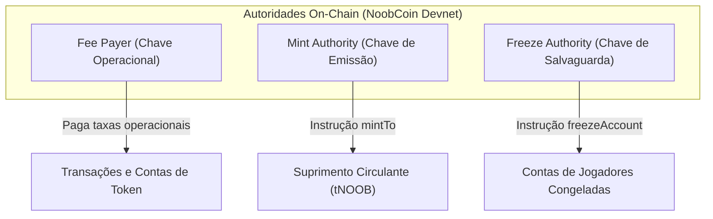

# NOOBCOIN — REVISÃO DE SEGURANÇA PRÉ-GERAÇÃO DE CHAVE E GATE DE GOVERNANÇA (PRE-KEY SECURITY REVIEW)
## Projeto NoobRPG | Missão 30G | Pacotes: `@noobrpg/solana-worker` e `@noobrpg/server`

---

## 1. Declaração de Escopo e Regra Inviolável

Este relatório consolida a auditoria independente e prévia a qualquer geração de chaves criptográficas para o token **NoobCoin (tNOOB)** na rede **Solana Devnet**.

> [!CAUTION]
> **GARANTIA INEGOCIÁVEL DE SEGURANÇA OPERACIONAL (MISSÃO 30G):**
> Durante toda a execução desta missão:
> - **NENHUMA CHAVE PRIVADA OU SEED PHRASE FOI GERADA OU IMPORTADA.**
> - **NENHUM ARQUIVO CONTENDO MATERIAL CRIPTOGRÁFICO SECRETO FOI CRIADO OU MODIFICADO.**
> - **NENHUM SOL FOI SOLICITADO A FAUCETS PÚBLICOS OU PRIVADOS.**
> - **NENHUMA TRANSAÇÃO ON-CHAIN FOI ASSINADA OU TRANSMITIDA.**
> - **NENHUM MINT OU TOKEN FOI CRIADO OU EMITIDO NA BLOCKCHAIN.**
> - **NENHUMA CONEXÃO COM MAINNET OU TESTNET OCORREU OU FOI HABILITADA.**
> - **NENHUM CONTROLE FAIL-CLOSED OU SALVAGUARDA DE REDE FOI ENFRAQUECIDO.**
> - **NENHUM VALOR DE SEGREDO FOI LIDO, COPIADO, IMPRESSO OU TRANSMITIDO.**

---

## 2. Fase 1 — Revisão Independente dos Documentos Existentes

A auditoria comparou minuciosamente os documentos localizados na raiz do repositório (`d:/NoobRPG/`) e na pasta canônica de documentação (`d:/NoobRPG/docs/`):

### 2.1 Mapeamento e Topologia Documental
- **Arquivos Stubs / Ponteiros na Raiz:**
  - `NOOBCOIN_HUMAN_APPROVAL_PACKAGE.md`: Arquivo de redirecionamento de 12 linhas apontando formalmente para `docs/NOOBCOIN_HUMAN_APPROVAL_PACKAGE.md`.
  - `NOOBCOIN_DEVNET_PREFLIGHT.md`: Stub de 13 linhas apontando para `docs/NOOBCOIN_DEVNET_PREFLIGHT.md`.
  - `NOOBCOIN_DEVNET_CONNECTIVITY_REPORT.md`: Stub de 14 linhas apontando para `docs/NOOBCOIN_DEVNET_CONNECTIVITY_REPORT.md`.
  - `NOOBCOIN_DEVNET_TEST_EVIDENCE.md`: Stub de 13 linhas apontando para `docs/NOOBCOIN_DEVNET_TEST_EVIDENCE.md`.
- **Arquivos Canônicos Completos (Dupla Paridade):**
  - `docs/NOOBCOIN_WALLET_CUSTODY_PLAN.md` e `NOOBCOIN_WALLET_CUSTODY_PLAN.md` (idênticos).
  - `docs/NOOBCOIN_DEVNET_WALLET_RUNBOOK.md` e `NOOBCOIN_DEVNET_WALLET_RUNBOOK.md` (idênticos).
  - `docs/NOOBRPG_CREDENTIAL_REMEDIATION.md` (localizado exclusivamente em `docs/`).

### 2.2 Análise de Decisões, Recomendações e Riscos

| Item Avaliado | Classificação Factual | Fonte Canônica | Análise de Risco / Reversibilidade |
| :--- | :---: | :--- | :--- |
| **Programa SPL Token Original** | **Proposta Pendente** | `NOOBCOIN_HUMAN_APPROVAL_PACKAGE.md` | Recomendado por maturidade e compatibilidade. Reversível antes do deploy do mint. |
| **Supply Piloto de 1.000.000 tNOOB** | **Proposta Pendente** | `NOOBCOIN_HUMAN_APPROVAL_PACKAGE.md` | Previne poluição de estado na Devnet e expectativas irreais. Reversível antes do mint. |
| **Decimais (6 casas)** | **Proposta Pendente** | `NOOBCOIN_TOKENOMICS.md` | Alinhado com inteiros seguros (`BigInt` / `amountRaw`). Reversível antes do mint. |
| **Custódia Local em secrets/ (0600)** | **Proposta Pendente** | `NOOBCOIN_WALLET_CUSTODY_PLAN.md` | Isolamento em disco fora do Git e de variáveis de ambiente. Reversível a qualquer tempo. |
| **Revogação da Mint Authority** | **Alerta Crítico** | `NOOBCOIN_WALLET_CUSTODY_PLAN.md` | **IRREVERSÍVEL**. Se revogada on-chain, o supply torna-se imutável e novas emissões são bloqueadas. |
| **Revogação da Freeze Authority** | **Alerta Crítico** | `NOOBCOIN_WALLET_CUSTODY_PLAN.md` | **IRREVERSÍVEL**. Se revogada on-chain, as contas tornam-se permanentemente incensuráveis. |
| **Rotação Cloudflare R2** | **Parcialmente Resolvida** | `NOOBRPG_CREDENTIAL_REMEDIATION.md` | Novas chaves aplicadas e S3 validado; **falta confirmação humana de revogação da chave antiga no painel**. |

---

## 3. Fase 2 — Revisão da Custódia e Arquitetura de Chaves

A auditoria inspecionou diretamente o código-fonte em [packages/solana-worker/src/](file:///D:/NoobRPG/packages/solana-worker/src/):

### 3.1 Achado Arquitetural Central: Ausência de Carregador Ativo
- **Estado Atual do Código:** O módulo [config.ts](file:///D:/NoobRPG/packages/solana-worker/src/config.ts#L69) declara e normaliza `payerKeypairPath: env.SOLANA_PAYER_KEYPAIR_PATH?.trim()`.
- **Inexistência de Leitura em Disco:** Nenhuma linha de código em produção (`index.ts`, `worker.ts`, `tokenService.ts`) executa `fs.readFileSync` ou `Keypair.fromSecretKey`. O worker em [index.ts](file:///D:/NoobRPG/packages/solana-worker/src/index.ts#L21) opera intencionalmente em **modo simulação/repouso**, impedindo qualquer carregamento acidental.
- **Testes Automatizados:** As suítes de teste utilizam estritamente o `MockTokenService` ou instanciam pares efêmeros via `Keypair.generate()` que residem exclusivamente na memória volátil do processo de teste do Node.js.

### 3.2 Diferenciação dos Três Níveis de Segurança da Custódia

A engenharia do projeto rejeita a afirmação de que "salvar a chave em arquivo local é suficiente". A segurança deve ser analisada em 3 camadas independentes:

1. **Camada 1: Proteção Contra Commits e Versionamento (Git)**
   - O arquivo [.gitignore](file:///D:/NoobRPG/.gitignore) exclui com sucesso `*keypair*.json`, `*secret*.json`, `*.key`, `*.pem`, `.env*`.
   - Essa camada protege **apenas contra envio acidental para o repositório remoto**, mas não protege o arquivo dentro do sistema de arquivos local.
2. **Camada 2: Controle de Acesso do Sistema Operacional (OS / ACLs)**
   - Proteção de permissões no filesystem (`chmod 600` em Linux/macOS; remoção de herança e concessão exclusiva ao usuário em Windows via `icacls`).
   - Essa camada impede que outros usuários do host ou processos sem privilégio leiam o arquivo.
3. **Camada 3: Proteção Contra Comprometimento do Host e Processos**
   - Se o host for invadido, sofrer infecção por malware, dump de memória do processo Node.js ou inspeção via depuradores (e.g., inspeção de heap em crash dumps), a chave em disco ou na memória volátil pode ser comprometida.
   - *Mitigação:* Em ambiente de teste Devnet, o saldo financeiro é nulo e a carteira é descartável. Para eventual avanço futuro rumo à produção (Mainnet), a arquitetura exigirá HSM em nuvem (Cloud KMS / AWS KMS) ou governança Multi-Sig (Squads Protocol), sem chaves quentes locais.

### 3.3 Recomendações de Hardening para o Futuro Carregador de Chaves
Quando o carregador de arquivos for implementado em missão futura autorizada, ele deve obrigatoriamente:
- Validar que o caminho resolve para dentro do diretório `packages/solana-worker/secrets/`.
- Rejeitar caminhos absolutos arbitrários fora da raiz do worker ou apontando para pastas do cliente ou servidor.
- Capturar erros de parsing em blocos `try/catch` sanitizados, garantindo que exceções não exibam buffers de bytes ou trechos do arquivo JSON no console.

---

## 4. Fase 3 — Revisão e Matriz de Decisão das Autoridades do Token

Na arquitetura SPL Token, cada autoridade possui escopo e criticidade distintos:

### Matriz Comparativa Detalhada

| Autoridade | Finalidade Técnica | Responsável / Custódia | Impacto de Comprometimento | Procedimento de Substituição | Consequências de Revogação |
| :--- | :--- | :--- | :--- | :--- | :--- |
| **Fee Payer** | Pagar taxas de transação (5.000 lamports) e aluguel de ATAs (~0.00204 SOL). | Worker / Chave isolada em disco (`devnet-payer-keypair.json`). | **Baixo/Moderado:** Esgotamento de SOL de teste gratuitos; negação temporária de serviço do worker. | Interromper worker, gerar novo keypair local, atualizar configuração e reiniciar com reconciliação. | Não é uma autoridade de mint; a falta de fundos paralisa o worker, mas não altera regras on-chain. |
| **Mint Authority** | Autorizar cunhagem de novos tokens (`mintTo`). | Desenvolvedor / Chave de alta segurança ou carteira do worker em teste. | **Crítico:** Emissão ilimitada e não autorizada de tokens, diluindo ou quebrando a economia do jogo. | Executar `spl-token authorize <MINT> mint <NOVA_PUBKEY>`. | **IRREVERSÍVEL:** A revogação (`spl-token authorize <MINT> mint --disable`) impede para sempre qualquer nova emissão daquele mint. O supply torna-se fixo. |
| **Freeze Authority** | Congelar/descongelar contas de token (`freezeAccount` / `thawAccount`). | Desenvolvedor / Chave de salvaguarda administrativa. | **Médio:** Risco de congelamento malicioso de contas de jogadores legítimos (censura). | Executar `spl-token authorize <MINT> freeze <NOVA_PUBKEY>`. | **IRREVERSÍVEL:** A revogação (`spl-token authorize <MINT> freeze --disable`) torna o token **definitivamente incensurável**. Nenhuma conta poderá jamais ser congelada. |

---

## 5. Fase 4 — Verificação de Barreiras e Testes Reproduzíveis

A reprodução dos testes de segurança existentes foi executada sem criar segredos ou chaves. Os resultados foram auditados por categoria independente:

### 5.1 Categoria A: Segurança Operacional e Salvaguarda de Credenciais (Server)
- **Comando:** `cmd /c npx tsx --test packages/server/tests/security_credentials_guard.test.ts`
- **Resultados:** **6/6 testes aprovados** (577 ms).
  - Validação estrita das regras do `.gitignore` contra variantes de `.env`, chaves `.pem`, `.key`, `*keypair*.json`: **PASS**
  - Verificação de arquivos rastreados no Git (Zero Tracked Secrets): **PASS**
  - Integridade e ausência de segredos reais nos templates `.env.example`: **PASS**
  - Exceção segura e sanitizada no `R2StorageClient`: **PASS**
  - Máscara de sanitização de tokens e credenciais em logs: **PASS**

### 5.2 Categoria B: Proteção Anti-Mainnet e Bloqueio de Rede (Solana Worker)
- **Comando:** `cmd /c npx tsx --test packages/solana-worker/tests/network_guard.test.ts`
- **Resultados:** **10/10 testes aprovados** (208 ms).
  - Rejeição estrita de `SOLANA_NETWORK` indefinido ou apontando para `mainnet`: **PASS**
  - Rejeição de URLs públicas sem termo explícito `devnet`: **PASS**
  - Bloqueio matemático algorítmico do Genesis Hash da Mainnet (`5eykt4UsFv8P8NJdTREpY1vzqKqZKvdpKuc147dw2N9d`): **PASS**
  - Bloqueio do Genesis Hash da Testnet: **PASS**
  - Aceitação estrita do Genesis Hash da Devnet (`EtWTRABZaYq6iMfeYKouRu166VU2xqa1wcaWoxPkrZBG`): **PASS**

### 5.3 Categoria C: Validação Fail-Closed e Resiliência Operacional (Solana Worker)
- **Comando:** `cmd /c npx tsx --test packages/solana-worker/tests/fail_closed_resilience.test.ts`
- **Resultados:** **18/18 testes aprovados** (1.09 s).
  - Aborto do NetworkGuard diante de cluster offline ou desconhecido: **PASS**
  - Preservação do status `SUBMITTED` em timeouts de RPC sem duplicação de saldo: **PASS**
  - Reconciliação automática pós-crash do processo (Crash Recovery): **PASS**
  - Isolamento de concorrência (`Promise.all` simultâneo): **PASS**
  - Rejeição de valores fracionários (floats) e números acima de `MAX_SAFE_INTEGER`: **PASS**
  - Zero bypass: Nenhuma API ou rota alternativa contorna o `processBatch`: **PASS**

### 5.4 Categoria D: Distribuição Controlada e Máquina de Estados (Solana Worker)
- **Comando:** `cmd /c npx tsx --test packages/solana-worker/tests/worker_distribution.test.ts`
- **Resultados:** **10/10 testes aprovados** (1.03 s).
  - Ciclo de estados `APPROVED -> QUEUED -> SUBMITTED -> CONFIRMED`: **PASS**
  - Idempotência estrita em reprocessamento de lote: **PASS**
  - Zero Client Trust comprovado: cliente web não possui caminhos de envio on-chain: **PASS**

> [!NOTE]
> **Total de Asserções Auditadas nesta Missão:** **44 testes unitários e de integração de segurança aprovados com 100% de sucesso**. Nenhuma métrica foi inflada ou mesclada indevidamente com testes E2E de gameplay.

---

## 6. Fase 5 — Auditoria de Estado da Remediação Cloudflare R2

Para garantir a transparência da governança, o estado da remediação foi dividido em três dimensões factuais:

1. **Hardening Local do Código (🟢 CONCLUÍDO):**
   - O `.gitignore` bloqueia todas as variantes de arquivos `.env`.
   - Os templates `.env.example` utilizam unicamente valores de demonstração seguros.
   - O `R2StorageClient` opera em modo fail-closed caso variáveis estejam ausentes.
2. **Validação Operacional com Novas Credenciais (🟢 CONCLUÍDO):**
   - O proprietário gerou novas credenciais no painel Cloudflare e as aplicou no `.env` local.
   - O script `packages/server/scripts/test_r2_connectivity.ts` validou a autenticação via S3 API e confirmou a criação e presença do bucket `noobrpg-assets` com código de saída 0.
3. **Revogação Externa de Credenciais Antigas (🟡 PENDENTE DE CONFIRMAÇÃO):**
   - **Ponto de Auditoria:** Criar novas credenciais no Cloudflare R2 **não invalida automaticamente** os tokens e chaves de acesso emitidos anteriormente.
   - Para que a pendência seja declarada integralmente encerrada, o proprietário deve confirmar formalmente que os identificadores antigos expostos na auditoria inicial foram excluídos/revogados no dashboard da Cloudflare.

---

## 7. Fase 6 — Lista Formal de Decisões Humanas Pendentes

Nenhum procedimento futuro de geração de carteira ou emissão de token poderá ocorrer antes da deliberação formal sobre os seguintes 7 pontos:

1. **Programa de Token:** Aprovação formal do uso de **SPL Token Original** (`TokenkegQfeZyiNwAJbNbGKPFXCWuBvf9Ss623VQ5DA`) para o token de testes.
2. **Suprimento de Teste:** Aprovação do suprimento piloto de **1.000.000 tNOOB** (Opção A).
3. **Casas Decimais:** Aprovação do padrão de **6 casas decimais**.
4. **Governança de Autoridades:** Decisão explícita sobre manter ativas ou revogar a `Mint Authority` e a `Freeze Authority` após os testes de Devnet (ciente de que a revogação é **irreversível**).
5. **Modelo de Custódia Local:** Aprovação do armazenamento da chave do Fee Payer em `packages/solana-worker/secrets/devnet-payer-keypair.json` com permissões de sistema restritas (`0600` / ACLs NTFS) e isolada de variáveis de ambiente puras.
6. **Confirmação da Remediação R2:** Confirmação explícita de que as credenciais antigas do Cloudflare R2 foram deletadas/revogadas no painel da Cloudflare.
7. **Autorização para Futura Missão de Chave:** Autorização separada e formal para que uma futura missão gere a carteira local de teste e solicite airdrop na Devnet conforme o runbook.

---

## 8. Parecer Final do Gate de Segurança

| Portão de Segurança | Classificação Final | Justificativa Técnica |
| :--- | :---: | :--- |
| **Missão 30G (Pre-Key Security Review)** | 🟢 **`READY FOR HUMAN REVIEW`** | Revisão independente documentada, limites e irreversibilidades mapeados, testes reproduzidos e decisões humanas estruturadas. |
| **Geração de Chaves On-Chain** | 🔴 **`BLOCKED (No-Keypair Policy)`** | Bloqueado aguardando deliberação humana formal na Seção 10 de `NOOBCOIN_HUMAN_APPROVAL_PACKAGE.md`. |
| **Revogação Externa R2** | 🟡 **`PENDING CONFIRMATION`** | Conectividade das novas chaves verificada; aguarda confirmação de exclusão das chaves antigas no painel web. |

> [!IMPORTANT]
> **DECLARAÇÃO DE ENCERRAMENTO:**
> Nenhuma chave privada foi gerada.
> Nenhuma carteira foi importada.
> Nenhuma transação foi assinada ou transmitida.
> O sistema encerra esta missão em repouso estático, aguardando deliberação humana.
