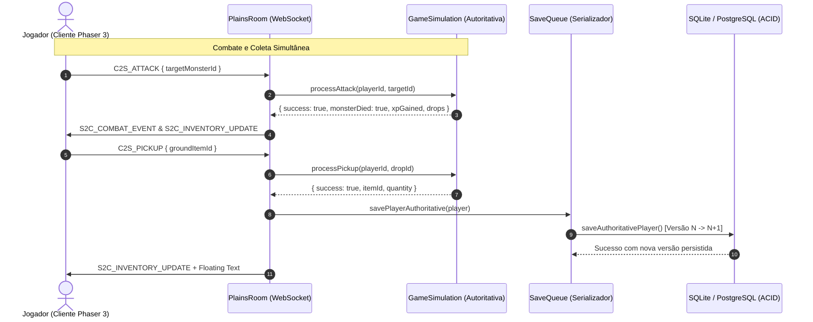

# Relatório da Missão 5 — Vertical Slice Jogável, Auditoria de Integridade e Hardening Multiplayer

**Data:** 19 de Outubro de 2026  
**Projeto:** NoobRPG (`D:\NoobRPG`)  
**Status da Missão:** CONCLUÍDA COM SUCESSO (114 Testes Aprovados)

---

## 1. Resumo Executivo & Objetivos

A **Missão 5** realizou uma auditoria profunda de integridade, hardening de concorrência, consistência relacional e refinamento de experiência (UX) sobre o loop completo de RPG estabelecido na Missão 4.

Todos os subsistemas de combate, inventário, crafting, drops, movimentação, transições entre mapas e persistência foram testados contra cenários adversos de concorrência simultânea (`Promise.all`), ações de jogadores mortos, tentativas de desvio de mapa e mensagens fora de ordem.

### Baseline vs. Resultado Final
| Métrica | Baseline (Início Missão 5) | Resultado Final (Pós-Hardening) |
| :--- | :---: | :---: |
| **Testes `@noobrpg/shared`** | 12 aprovados | **12 aprovados** |
| **Testes `@noobrpg/server`** | 76 aprovados (10 suítes) | **87 aprovados (11 suítes)** |
| **Testes Live Server E2E** | 15 aprovados | **15 aprovados** |
| **Total Global de Testes** | **103 aprovados** | **114 aprovados (100% verde)** |
| **Build de Produção Vite** | 12.95s (0 erros) | **8.19s (0 erros, 0 avisos)** |
| **Zero Client Trust** | Parcial em ações de mortos | **100% estrito em todas as operações** |
| **Persistência Concorrente** | Sem fila de serialização | **Serializada por jogador via `saveQueue`** |
| **Transição de Mapas** | Unidirecional nos portões | **Bidirecional com validação física mútua** |

---

## 2. Falhas e Vulnerabilidades Identificadas na Auditoria

Durante a auditoria técnica estática e de runtime, foram identificadas e corrigidas as seguintes falhas:

1. **Permissão de Ações por Jogadores Derrotados (`PLAYER_DEAD`):**
   - *Problema:* Em [GameSimulation.ts](file:///d:/NoobRPG/packages/server/src/simulation/GameSimulation.ts), os métodos `processGather`, `processPickup`, `processCraft`, `processUseItem` e `processEquip` não verificavam se o jogador estava vivo (`!player.isAlive()`). Um jogador com HP zerado aguardando respawn conseguia coletar drops, forjar equipamentos na bigorna, consumir poções e equipar itens.
   - *Correção:* Injetada checagem explícita `if (!player.isAlive()) return { success: false, reason: 'PLAYER_DEAD' };` em todos os fluxos operacionais e em [ServerGatheringNode.ts](file:///d:/NoobRPG/packages/server/src/simulation/ServerGatheringNode.ts).
2. **Desvio de Mapa Não-Autorizado em `C2S_MOVE`:**
   - *Problema:* No [PlainsRoom.ts](file:///d:/NoobRPG/packages/server/src/multiplayer/PlainsRoom.ts), o handler da mensagem `C2S_MOVE` continha `this.simulation.setPlayerMap(characterId, payload.mapKey)`. Um cliente malicioso poderia alterar o `mapKey` do seu avatar arbitrariamente sem passar pela validação física de portões em `processChangeMap`.
   - *Correção:* Removida a alteração unilateral de mapa em `C2S_MOVE`. A troca de mapa tornou-se estritamente condicionada ao comando autoritativo `C2S_CHANGE_MAP`.
3. **Fuga Arbitrária das Planícies para a Vila Inicial:**
   - *Problema:* O método `processChangeMap` validava proximidade física dos portões na Vila Inicial, mas não impunha verificação geográfica quando o jogador estava nas Planícies (`map_prototype`). Um jogador no meio do mapa selvagem $(800, 600)$ podia se teletransportar instantaneamente para a segurança da vila.
   - *Correção:* Adicionada validação de proximidade da conexão de retorno nas Planícies em $(180, 160)$ com raio de tolerância $\le 90\text{ px}$. Jogadores fora de alcance recebem `TOO_FAR_FROM_MAP_EXIT`.
4. **Conflito de Versão em Salvamentos Concorrentes Rápidos:**
   - *Problema:* Disparos concorrentes de salvamento no banco de dados para o mesmo personagem (ex: coletar dois drops em rápida sucessão) podiam colidir no controle de versão otimista (`version = expectedVersion + 1`), gerando erro de concorrência.
   - *Correção:* Implementada a fila assíncrona serializada `saveQueue: Map<string, Promise<void>>` no [PlainsRoom.ts](file:///d:/NoobRPG/packages/server/src/multiplayer/PlainsRoom.ts). Cada salvamento aguarda a conclusão da transação anterior do mesmo jogador, garantindo incremento ordenado e zero falhas por corrida de banco.
5. **Silenciamento de Erros de Combate e Coleta:**
   - *Problema:* Se um ataque ou coleta falhasse no servidor (`OUT_OF_RANGE`, `COOLDOWN_ACTIVE`), o [PlainsRoom.ts](file:///d:/NoobRPG/packages/server/src/multiplayer/PlainsRoom.ts) não emitia `S2C_ERROR` ao cliente, deixando o jogador sem retorno do motivo da ação não ter sido aceita.
   - *Correção:* Envio explícito de `sendError` para `ATTACK_REJECTED`, `SKILL_REJECTED` e `GATHER_REJECTED`. No cliente [WorldScene.ts](file:///d:/NoobRPG/packages/client/src/scenes/WorldScene.ts), o `onError` passou a exibir balão visual flutuante (`floating-text`) em vermelho acima da cabeça do avatar.
6. **Ausência de Indicador Visual nos Portões e Estrada de Retorno:**
   - *Problema:* O jogador não tinha feedback visual de onde ficava a área de interação dos portões da vila nem como retornar das Planícies para a vila sem o botão dev.
   - *Correção:* Implementado `gateHintText` flutuante em [WorldScene.ts](file:///d:/NoobRPG/packages/client/src/scenes/WorldScene.ts) (`[F] Portão Norte (Planícies)`, `[F] Portão Sul (Planícies)` e `[F] Estrada para a Vila Inicial`), permitindo trânsito bidirecional suave ao pressionar `[F]`.

---

## 3. Arquitetura do Hardening Multiplayer

---

## 4. Matriz da Nova Suíte de Testes (Missão 5)

A suíte dedicada [packages/server/tests/gameplay_hardening.test.ts](file:///d:/NoobRPG/packages/server/tests/gameplay_hardening.test.ts) foi implementada com **11 testes exaustivos (100% aprovados)**:

| Nº | Caso de Teste | Validação de Segurança / Concorrência | Resultado |
| :---: | :--- | :--- | :---: |
| **1.1** | Ataque a Monstro Inexistente / Morto | Rejeição com `INVALID_OR_DEAD_TARGET` sem concessão de dano ou XP | **APROVADO** |
| **1.2** | Ações de Jogador Morto no Combate | Ataque básico e habilidade 1 bloqueados com `PLAYER_DEAD` | **APROVADO** |
| **1.3** | Ataque Concorrente de 2 Jogadores | Ataques simultâneos via `Promise.all`: exatamente 1 morte e XP concedido uma única vez | **APROVADO** |
| **1.4** | Integridade do Respawn | Monstro renasce com HP máximo após `respawnTimeMs` sem duplicação de instâncias | **APROVADO** |
| **2.1** | Race Condition na Coleta de Drops | Dois jogadores tentando recolher o mesmo drop (`Promise.all`): exatamente 1 sucesso, 1 `ITEM_NOT_FOUND`, sem duplicação | **APROVADO** |
| **2.2** | Zero Client Trust em Itens por Mortos | Bloqueio de pickup, craft, poções e equipamentos se jogador estiver com HP zerado | **APROVADO** |
| **2.3** | Crafting Concorrente com Mesmos Materiais | Tentativa simultânea de forjar com materiais para 1 item: 1 sucesso e 1 `MISSING_INGREDIENTS` | **APROVADO** |
| **2.4** | Troca Autoritativa de Equipamentos | Devolução da arma anterior ao inventário, validação de `requiredLevel` e recálculo de atributos | **APROVADO** |
| **2.5** | Bloqueio de Transição Fora de Alcance | Rejeição se distante dos portões Norte e Sul na Vila (`TOO_FAR_FROM_MAP_EXIT`) | **APROVADO** |
| **2.6** | Bloqueio de Fuga nas Planícies | Rejeição de transição para a vila se longe do ponto de retorno $(180, 160)$ | **APROVADO** |
| **3.1** | Sessão Completa de Ponta a Ponta | Ciclo real: Criação -> Tutorial -> Forja -> Exploração -> Combate -> Loot/XP -> Retorno -> Persistência -> Reconexão | **APROVADO** |

---

## 5. Resumo Geral de Testes e Prontidão

| Componente / Suíte | Testes | Status | Tempo de Execução |
| :--- | :---: | :---: | :---: |
| `@noobrpg/shared` | 12 | **PASS (100%)** | 263 ms |
| `@noobrpg/server` (11 suítes) | 87 | **PASS (100%)** | 9.74 s |
| E2E Live Server (`e2e_full_game_live.ts`) | 15 | **PASS (100%)** | 1.30 s |
| **Total Global de Testes** | **114** | **PASS (100%)** | **11.30 s** |
| **Build de Produção do Cliente** | 1 | **PASS (100%)** | **8.19 s** |

---

## 6. Arquivos Alterados

- `packages/server/src/simulation/GameSimulation.ts`: Validações de jogador vivo em coleta, forja, pickup, itens e equipamentos; validação de proximidade bidirecional nas saídas das Planícies e da Vila Inicial.
- `packages/server/src/simulation/ServerPlayer.ts`: Checagem de `isAlive()` em `useConsumable()` e `equipItem()`.
- `packages/server/src/simulation/ServerGatheringNode.ts`: Checagem de `player.isAlive()` em `canInteract()`.
- `packages/server/src/multiplayer/PlainsRoom.ts`: Serialização de persistência via `saveQueue`, envio de `S2C_ERROR` em rejeições de combate e coleta, e remoção de manipulação não-autorizada de mapa em `C2S_MOVE`.
- `packages/client/src/scenes/WorldScene.ts`: Indicador flutuante `gateHintText` para os portões da vila e estrada das planícies; trânsito bidirecional ao pressionar `[F]`; feedback visual flutuante para erros recebidos do servidor.
- `packages/server/tests/gameplay_hardening.test.ts`: Nova suíte com 11 testes cobrindo todas as frentes de concorrência, consistência e sessão completa.

---

## 7. Recomendações Técnicas para a Missão 6

1. **Expansão de Conteúdo Selvagem:** Adicionar área de masmorra ou floresta dos goblins conectada às planícies com monstros de maior nível e drops de ingredientes avançados.
2. **Sistema de Grupos (Party):** Divisão automática e autoritativa de XP e ouro entre jogadores próximos em grupo.
3. **Fade Visual de Transição:** Adicionar efeito suave de tela escura durante o carregamento de mapa no cliente Phaser 3.
