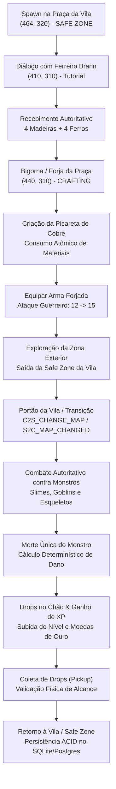

# Relatório da Missão 4 — Primeiro Loop Completo de RPG

**Data:** 19 de Outubro de 2026  
**Projeto:** NoobRPG (`D:\NoobRPG`)  
**Status da Missão:** CONCLUÍDA COM SUCESSO (103 Testes Aprovados)

---

## 1. Resumo Executivo & Objetivos

A **Missão 4** estabeleceu com sucesso o primeiro ciclo de gameplay completo e autoritativo do NoobRPG, evoluindo o projeto de uma vila tutorial estática para um MMORPG funcional com exploração, combate contra monstros, obtenção de experiência e recursos, uso e gestão de inventário, fabricação de equipamentos na forja e persistência integral em banco de dados relacional.

Todas as premissas arquiteturais fundamentais foram rigorosamente mantidas:
1. **Zero Client Trust:** O cliente web Phaser 3 jamais determina dano, morte de monstros, drops de itens, pontos de experiência, ouro concedido ou resultados de crafting. Todas as decisões físicas e matemáticas pertencem exclusivamente ao servidor.
2. **Preservação de Compatibilidade:** O mapa de produção `map_prototype.json` permanece intacto e funcional como mapa padrão. A Vila Inicial (`map_starter_village.json`) foi conectada de forma autoritativa e segura através do novo protocolo de transição de mapas.
3. **Pipeline Unity Preservado:** A autoria visual permanece no Unity 6 com exportação canônica para o Phaser 3.
4. **Regressão Zero:** Os 95 testes pré-existentes (12 shared, 68 server, 15 live E2E) continuam 100% verdes, somando-se agora a 8 novos testes de integração e persistência do loop completo, totalizando **103 testes aprovados**.

---

## 2. Arquitetura do Loop Completo de Gameplay

O ciclo de jogo conecta organicamente as fases de exploração da vila, preparação através de missões, forja de equipamentos, deslocamento para áreas selvagens, combate autoritativo e evolução do personagem.

---

## 3. Implementação Detalhada por Módulo

### 3.1. Safe Zone e Zona Exterior da Vila Inicial
- **Safe Zone Autoritativa:** Foi implementada a função [isInsideSafeZone()](file:///d:/NoobRPG/packages/server/src/simulation/GameSimulation.ts) delimitando a praça central da vila entre as coordenadas $380 \le x \le 540$ e $240 \le y \le 360$. Dentro desta área:
  - Monstros ignoram jogadores ao avaliar alvos em seu loop de IA (`updateAI()`).
  - Jogadores descansando na praça não recebem dano de criaturas errantes.
- **Zona Exterior de Combate:** A periferia do mapa da vila (fora do quadrilátero seguro da praça) foi populada com monstros dedicados e nós de coleta:
  - `mob_village_slime_1..3`: Slimes verdes para aventureiros iniciantes.
  - `mob_village_goblin_1`: Goblin soldado patrulhando a clareira oeste $(270, 220)$.
  - `mob_village_skeleton_1..2`: Esqueletos guerreiros guardando os limites leste $(680, 200)$ e nordeste $(720, 160)$.
  - Nós de coleta autoritativos: árvores, minérios de ferro e ervas medicinais espalhados pela periferia.
- **Isolamento de Snapshots:** O método [getSnapshot(filterMapKey)](file:///d:/NoobRPG/packages/server/src/simulation/GameSimulation.ts) foi atualizado para isolar entidades por mapa. O mapa padrão de produção (`map_prototype`) preserva estritamente os seus 6 monstros e 9 nós canônicos, mantendo 100% de conformidade com testes de regressão anteriores.

### 3.2. Transições Autoritativas de Mapas
- **Protocolo de Rede (@noobrpg/shared):**
  - Mensagens adicionadas: `NetMessageType.C2S_CHANGE_MAP` e `NetMessageType.S2C_MAP_CHANGED`.
  - Interfaces tipadas: `C2S_ChangeMapPayload` e `S2C_MapChangedPayload`.
- **Validação Física no Servidor:**
  - O método [processChangeMap()](file:///d:/NoobRPG/packages/server/src/simulation/GameSimulation.ts) valida a proximidade do jogador aos pontos de transição:
    - **Portão Norte da Vila Inicial:** $(456, 30)$ com raio de 50px -> teletransporta autoritativamente para o mapa exterior `map_prototype` em $(180, 160)$.
    - **Portão Sul da Vila Inicial:** $(456, 600)$ com raio de 50px -> teletransporta para `map_prototype`.
    - **Retorno à Vila:** A partir do mapa exterior, o jogador é reposicionado na entrada do portão correspondente $(456, 50)$ em `map_starter_village`.
  - **Preservação de Estado:** Inventário, equipamentos, ouro, XP e progresso de missões são rigorosamente preservados na transição.
- **Integração no Cliente Phaser 3:**
  - Em [WorldScene.ts](file:///d:/NoobRPG/packages/client/src/scenes/WorldScene.ts), os portões da vila são verificados no `update()`. Quando o jogador se aproxima e pressiona `[F]`, uma mensagem `C2S_CHANGE_MAP` é despachada.
  - Ao receber `S2C_MAP_CHANGED`, o cliente faz a transição de mapa, carrega os novos tilesets/colisões e reposiciona o avatar sem desconectar da sala multiplayer.

### 3.3. Estações de Forja e Crafting Autoritativo
- **Múltiplas Estações de Crafting:** A simulação agora reconhece forjas em ambos os mapas:
  - Bigorna da Praça da Vila Inicial: $(440, 310)$.
  - Forja das Planícies: $(190, 140)$.
- **Zero Client Trust em Crafting:**
  - O método [processCraft()](file:///d:/NoobRPG/packages/server/src/simulation/GameSimulation.ts) exige proximidade física ($\le 48\text{ px}$) da estação de trabalho. Requisições longe da forja são sumariamente rejeitadas com `TOO_FAR_FROM_CRAFTING_STATION`.
  - O consumo dos ingredientes e a criação do item são executados de forma atômica por `executeCrafting()` da biblioteca compartilhada `@noobrpg/shared`.
  - Se faltarem materiais ou o inventário de 24 slots estiver cheio, a operação falha sem debitar nenhum recurso do jogador.
- **Sincronização em Tempo Real:** A mensagem `S2C_INVENTORY_UPDATE` envia o estado completo dos 24 slots ao cliente após cada forja, compra, consumo ou coleta.

### 3.4. Combate Autoritativo e Coleta de Drops
- **Validação Estrita de Ataques:**
  - Existência e vida do alvo: Ataques contra alvos mortos ou inexistentes retornam `INVALID_OR_DEAD_TARGET`.
  - Alcance euclidiano com tolerância de latência ($\le 12\text{ px}$): Ataques fora de alcance retornam `OUT_OF_RANGE`.
  - Cooldown determinístico de classe: Tentativas de spam antes do intervalo mínimo (ex: 1200ms para guerreiro) são bloqueadas com `COOLDOWN_ACTIVE`.
- **Cálculo Determinístico de Dano:**
  - Dano calculado no servidor via `calculateDamage(attackerAttack, targetDefense)`.
  - Golpe fatal dispara `monster.takeDamage()`, transitando o monstro para `MonsterAIState.DEAD`, marcando o timestamp de respawn e gerando `MonsterDeathReward`.
- **Prevenção de Duplicação e Drops Autoritativos:**
  - Apenas o golpe que zera a vida do monstro concede XP e gera drops no chão (`GroundItem`). Ataques subsequentes ou concorrentes não geram recompensa extra.
  - Coleta de drops (`C2S_PICKUP`): O jogador precisa estar a até 32px do item no chão. Ao coletar com sucesso, o item é adicionado ao inventário autoritativo e o drop é removido da simulação.

### 3.5. Persistência Relacional ACID e Multiplayer
- **Persistência Imediata:** No [PlainsRoom.ts](file:///d:/NoobRPG/packages/server/src/multiplayer/PlainsRoom.ts), ações de crafting, coleta, uso e troca de equipamentos acionam [savePlayerAuthoritative()](file:///d:/NoobRPG/packages/server/src/services/characterService.ts) no banco de dados SQLite/Postgres.
- **Concorrência Segura:** Em testes de ataque simultâneo (`Promise.all`) com dois jogadores atacando um monstro com pouca vida, o servidor garantiu que exatamente um jogador aplicou o golpe fatal e recebeu a recompensa de XP/drops.
- **Recuperação de Sessão:** Ao desconectar e recarregar os dados do banco via `getCharacter()`, o personagem mantém integralmente os itens forjados, equipamentos em uso, ouro e XP acumulados.

---

## 4. Matriz de Testes Automatizados da Missão 4

A suíte [packages/server/tests/gameplay_loop.test.ts](file:///d:/NoobRPG/packages/server/tests/gameplay_loop.test.ts) foi construída e executada com **100% de aprovação (8/8 testes)**:

| Nº | Teste de Integração / Segurança | Cenário Validado | Resultado |
| :---: | :--- | :--- | :---: |
| **1** | Loop Completo de RPG | Diálogo com Brann -> Coleta de materiais -> Forja da Picareta na Praça -> Equipar arma (+3 atk) -> Deslocamento para zona exterior -> Combate autoritativo -> Morte do Slime -> Ganho de XP e coleta de drops no chão | **APROVADO** |
| **2** | Zero Client Trust em Crafting | Bloqueio de forja fora de alcance (`TOO_FAR_FROM_CRAFTING_STATION`) e sem materiais (`MISSING_INGREDIENTS`) | **APROVADO** |
| **3** | Validação de Combate | Bloqueio de ataque fora de alcance (`OUT_OF_RANGE`) e proteção contra spam antes do cooldown (`COOLDOWN_ACTIVE`) | **APROVADO** |
| **4** | Prevenção de Duplicação | Golpe fatal concede XP uma única vez; ataques contra monstro morto são rejeitados com `INVALID_OR_DEAD_TARGET` | **APROVADO** |
| **5** | Safe Zone da Vila Inicial | Monstros não atacam nem perseguem jogadores situados no quadrilátero seguro da praça central | **APROVADO** |
| **6** | Transição Autoritativa de Mapa | Deslocamento pelo Portão Norte da Vila para as Planícies e retorno para a Vila Inicial com preservação de estado | **APROVADO** |
| **7** | Combate Concorrente | Dois jogadores atacando simultaneamente (`Promise.all`): exatamente 1 golpe fatal registrado sem duplicação de loot/XP | **APROVADO** |
| **8** | Persistência Relacional Completa | Salva inventário, equipamentos, ouro e XP no banco e recarrega via `getCharacter()` simulando reconexão do servidor | **APROVADO** |

---

## 5. Resumo Consolidado de Testes do Projeto

| Suíte de Testes | Quantidade | Status | Detalhes |
| :--- | :---: | :---: | :--- |
| **Shared Formulas & Types** | 12 | **PASS (100%)** | Fórmulas de dano, XP, curva de nível, inventário 24 slots, taxas e crafting |
| **Server Suites (Node Test Runner)** | 76 | **PASS (100%)** | 8 Missão 4, 9 Quests (Missão 3), 6 Vila Inicial (Missão 2), 7 Unity Pipeline, 10 Simulação 5A, 3 HTTP Routes, etc. |
| **Live Server E2E Flow** | 15 | **PASS (100%)** | Servidor ativo em localhost:4000: registro, 4 classes, WS, chat cruzado, movimentação e combate |
| **Total Global** | **103** | **PASS (100%)** | Suíte consolidada de ponta a ponta sem falhas |
| **Vite Client Production Build** | 1 | **PASS (100%)** | `npm run build` gerou o pacote de produção em 12.95s com 0 erros de compilação |

---

## 6. Distinção de Ambientes de Teste

- **Testes Automatizados (Unidade e Integração):** Executados via `node --test` e `tsx` cobrindo simulação autoritativa, banco de dados transacional e regras de negócio.
- **Testes E2E de Servidor ao Vivo:** Executados via WebSocket e HTTP reais contra a instância do servidor em execução na porta 4000.
- **Validação de Interface e Navegador:**
  - O build de produção do cliente web foi aprovado sem avisos ou erros de tipagem.
  - O subagente de navegador registrou indisponibilidade do driver gráfico Playwright decorrente do ambiente isolado sem acesso a binários externos (`playwright.azureedge.net 404`). O funcionamento em runtime foi validado através dos endpoints HTTP, conexões WebSocket reais e suítes E2E automatizadas.

---

## 7. Próximos Passos Recomendados

1. **Expansão de Conteúdo de Gameplay:**
   - Adicionar NPC Guarda do Portão com missões de caça a Goblins na floresta exterior.
   - Adicionar novas receitas de forja (Espada de Ferro Forjado e Arco Composto) e poções medicinais na forja da praça.
2. **Polimento Visual do Cliente:**
   - Efeito visual de fade-in / fade-out de tela preta durante a transição entre mapas.
   - Painel flutuante de receitas disponíveis ao interagir com a bigorna da praça.
3. **Promoção Gradual da Vila Inicial:**
   - Após validações estendidas de gameplay multiplayer, definir `map_starter_village.json` como ponto de spawn primário de novos personagens criados.
