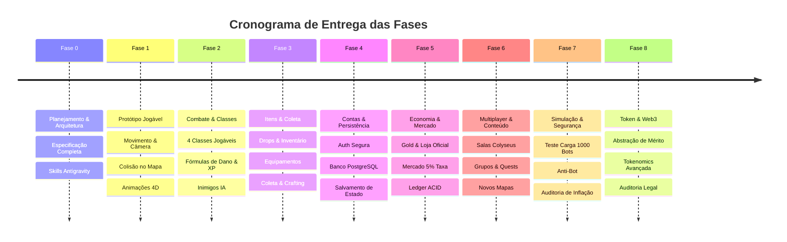

# Cronograma e Roadmap de Desenvolvimento — NoobRPG

## 1. Visão Geral das Fases

O projeto é executado de forma sequencial e incremental. Cada fase constrói sobre as fundações validadas da fase anterior, eliminando retrabalho e riscos técnicos precoces.

---

## 2. Detalhamento por Fase

### FASE 0 — Planejamento e Especificação Inicial (Fase Atual)
- **Status:** Em finalização para aprovação pelo usuário.
- **Entregas:**
  - 10 Documentos canônicos em `docs/`.
  - Configuração do repositório Git e `.gitignore`.
  - 8 Skills especializadas do Antigravity em `.agents/skills/`.
  - Análise de ferramentas do ambiente (Node v24, npm 11, Git).

### FASE 1 — Protótipo Jogável (Playable Slice)
- **Objetivo:** Estabelecer a base técnica do cliente Phaser 3 com Vite e movimentação fluida.
- **Entregas:**
  - Setup do monorepo (`packages/client`, `packages/shared`, `packages/server`).
  - Mapa de teste inicial em Tiled com camadas de colisão e profundidade (Y-sorting).
  - Personagem com movimentação em 8 direções e spritesheets de animação (Idle, Walk).
  - Câmera suave seguindo o jogador com limites de borda do mapa.
  - HUD básico exibindo coordenadas e taxa de quadros (60 FPS).

### FASE 2 — Combate e Progressão
- **Objetivo:** Implementar o loop de ação e crescimento de personagem.
- **Entregas:**
  - Inclusão dos 4 arquétipos de classes com atributos diferenciados.
  - Monstros iniciais com máquina de estados de IA (Patrulha, Perseguição, Ataque, Retorno).
  - Sistema de combate com cálculo de dano determinístico, alcance e cooldowns.
  - Concessão de XP conforme a fórmula matemática e animação de Level Up.

### FASE 3 — Itens, Coleta e Crafting
- **Objetivo:** Permitir acúmulo e transformação de recursos.
- **Entregas:**
  - Tabela de saques (loot tables) com geração de drops visuais no chão ao derrotar monstros.
  - Inventário em grade (24 slots) com arraste, tooltip e uso de consumíveis.
  - Sistema de equipamentos que modifica atributos em tempo real.
  - Bancadas de crafting para receitas básicas e nós de coleta de minério/madeira.

### FASE 4 — Persistência, Autenticação e Contas
- **Objetivo:** Garantir a continuidade do progresso do jogador.
- **Entregas:**
  - Backend com API de autenticação segura (registro, login, JWT e cookies HTTP-Only).
  - Migrações de banco de dados PostgreSQL para contas, personagens e itens.
  - Salvamento assíncrono e sincronização contínua de estado.

### FASE 5 — Economia, Loja Oficial e Mercado entre Jogadores
- **Objetivo:** Ativar a circulação de Gold e comércio.
- **Entregas:**
  - Loja Oficial de NPCs com compra e venda regulada.
  - Mercado entre jogadores com ofertas persistentes e taxa de 5% cobrada na liquidação.
  - Transações atômicas com locks pessimistas e ledger imutável de auditoria.

### FASE 6 — Multiplayer em Tempo Real e Conteúdo
- **Objetivo:** Conectar múltiplos jogadores no mesmo mundo compartilhado.
- **Entregas:**
  - Salas de mapa no Colyseus com interest management e sincronização de estado a 20Hz.
  - Sistema de chat local/global e grupos cooperativos (Party) com bônus de XP.
  - Adição de 2 novas regiões e masmorra com chefe.

### FASE 7 — Simulação Econômica, Stress Test e Segurança
- **Objetivo:** Blindar o jogo contra inflação, explorações e ataques.
- **Entregas:**
  - Simulações de economia com 1.000 agentes virtuais.
  - Auditoria de segurança e validação do checklist OWASP Game Security.
  - Otimizações de renderização e infraestrutura de rede.

### FASE 8 — Tokenomics e Blockchain (Etapa Futura)
- **Objetivo:** Expandir para tokens de utilidade e ativos digitais apenas quando o jogo for comprovadamente sustentável e aprovado juridicamente.
- **Entregas:**
  - Conversão dos Pontos de Mérito acumulados em sistema seguro de recompensas.
  - Contratos inteligentes auditados por terceiros.
