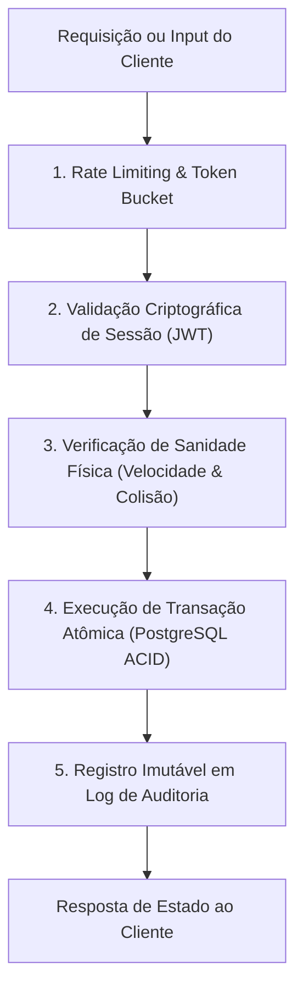

# Diretrizes de Segurança e Proteção Online — NoobRPG

## 1. Princípios de Segurança e Modelo de Ameaças
O NoobRPG adota os princípios do **OWASP Game Security Framework**. Como o jogo é executado no navegador, assume-se como premissa que **o ambiente do cliente é 100% hostil e vulnerável a inspeção, modificação de memória, scripts injetados e engenharia reversa**.

### 1.1 Regra de Ouro: Confiança Zero no Cliente (Zero Client Trust)
1. **O cliente nunca calcula ou envia:**
   - Dano causado a inimigos ou jogadores.
   - Concessão de pontos de XP ou aumentos de nível.
   - Geração de saques (drops) ou taxas de drop.
   - Saldo de Gold ou criação de itens.
   - Confirmação de conclusão de missões.
2. **O cliente apenas emite intenções:**
   - *Exemplo:* "Jogador pressionou a tecla de ataque na direção (X, Y)".
   - O servidor verifica cooldown, distância do alvo, linha de visão, calcula o dano, subtrai mana, aplica o dano e propaga o resultado.

---

## 2. Checklist Técnico de Proteção



### 2.1 Validação de Movimentação (Anti-Speedhack e Anti-Teleporte)
- A cada tick de simulação (50ms), o servidor calcula a distância percorrida pelo personagem:
  $$\text{Distância\_Máxima\_Permitida} = \text{Velocidade\_Base} \times \Delta t \times 1.15 \text{ (margem de tolerância de latência)}$$
- Se o vetor de deslocamento for maior que a tolerância física permitida, o servidor rejeita o movimento e força a posição do jogador de volta à última coordenada válida (*rubberbanding disciplinar*).
- Movimentos que tentem atravessar tiles com a flag `collides: true` são imediatamente bloqueados.

### 2.2 Prevenção de Duplicação de Itens e Race Conditions
- **Problema clássico:** Dois cliques simultâneos para comprar o mesmo item de mercado ou transferir item para baú enquanto se desconecta.
- **Solução Implementada:**
  1. Toda alteração de inventário e saldo ocorre dentro de uma transação única do PostgreSQL (`BEGIN ... COMMIT`).
  2. Uso de bloqueios pessimistas estritos:
     ```sql
     -- Exemplo de compra atômica no Marketplace
     SELECT * FROM marketplace_listings WHERE id = $1 FOR UPDATE;
     SELECT * FROM characters WHERE id = $buyerId FOR UPDATE;
     ```
  3. Constraints de banco de dados:
     `CONSTRAINT positive_balance CHECK (gold >= 0)`
     Se o saldo de um jogador tentasse ficar negativo por qualquer exploit, o próprio motor do PostgreSQL aborta a transação com Rollback instantâneo.

### 2.3 Registro de Auditoria Econômica (Economic Audit Trail)
Todas as operações de alteração de Gold e transferência de itens são registradas em uma tabela de log imutável (`ledger`):
- `id` (UUIDv7 sequencial)
- `account_id` / `character_id`
- `transaction_type` (LOOT, VENDOR_BUY, VENDOR_SELL, MARKET_SALE, MARKET_FEE, CRAFTING_COST)
- `amount` (variação de gold positiva ou negativa)
- `balance_after`
- `counterpart_id` (ID do outro jogador ou NPC envolvido)
- `created_at` (Timestamp do servidor)
- Alertas automatizados disparam caso uma conta acumule volume desproporcional em relação à sua média de tempo de jogo.

### 2.4 Autenticação e Proteção de Sessão
- Senhas armazenadas com **Argon2id** (ou bcrypt com fator de custo 12).
- Sessões via tokens JWT de curta duração (15 minutos) armazenados em memória no cliente, renovados por Refresh Tokens transmitidos via **Cookies HTTP-Only, Secure e SameSite=Strict**.
- Prevenção contra injeção de script (XSS) e Cross-Site Request Forgery (CSRF).
