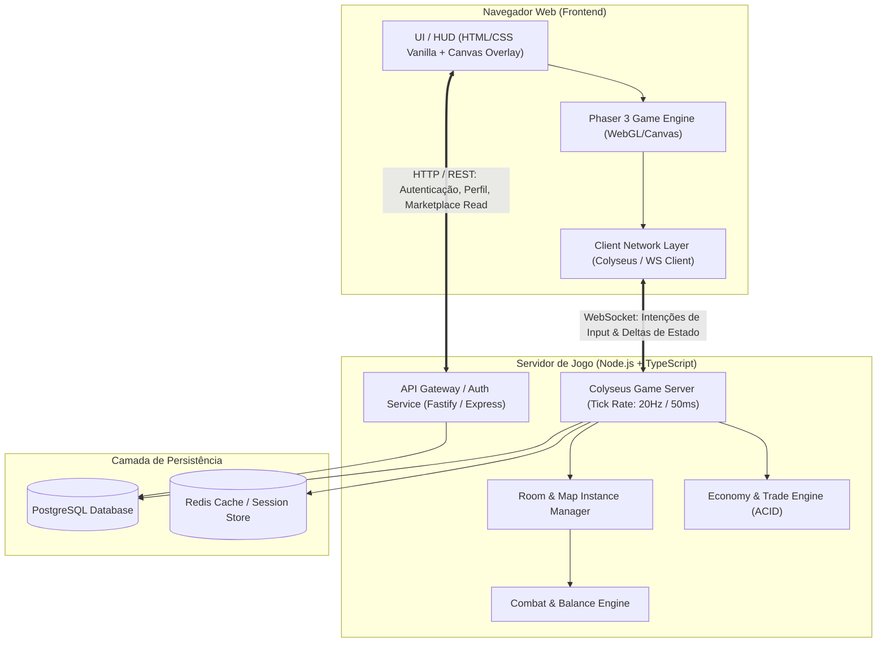

# Arquitetura Técnica — NoobRPG

## 1. Visão Geral da Arquitetura
O sistema é projetado seguindo o princípio fundamental de **Zero Client Trust (Confiança Zero no Cliente)**. O cliente web funciona como uma interface de renderização e coletor de intenções de entrada do jogador. Toda a simulação física, lógica de combate, cálculo de dano, geração de saques (drops), validação de inventário e liquidação de comércio é executada exclusivamente pelo servidor autoritativo.



---

## 2. Tecnologias Selecionadas e Justificativas

| Componente | Tecnologia | Motivo da Escolha | Limitações & Mitigações |
| :--- | :--- | :--- | :--- |
| **Engine do Cliente** | **Phaser 3 (TypeScript)** | Líder absoluta para jogos 2D web, aceleração WebGL automática com fallback Canvas, excelente ecossistema para Tiled maps e pixel art. | Overhead de garbage collection em objetos temporários; mitigado com object pooling para projéteis e textos de dano flutuante. |
| **Bundler do Cliente** | **Vite** | Inicialização instantânea, HMR (Hot Module Replacement) em milissegundos e build otimizado via esbuild/Rollup. | Requer configuração de assets estáticos com pixelated image rendering no CSS. |
| **Servidor de Gameplay** | **Colyseus (Node.js + TS)** | Gerenciamento de salas com schema de estado tipado, compactação de deltas (delta compression), reconnect token e integração direta com TypeScript. | Escala vertical por processo limitada pelo single thread do Node; mitigado por clusterização por mapa/sala. |
| **Camada Compartilhada** | **@noobrpg/shared** | Pacote NPM interno com tipos TypeScript, fórmulas de combate, schemas de dados, constantes de economia e definições de itens compartilhadas entre client e server. | Evita divergência de contratos e reduz duplicação de código a zero. |
| **Banco de Dados** | **PostgreSQL (v15+)** | Transações ACID estritas, suporte nativo a JSONB para inventários flexíveis e locks pessimistas (`SELECT FOR UPDATE`) para o marketplace. | Configuração local requer container ou banco em nuvem gerenciado (ex: Supabase / Neon). |
| **Cache / Sessão** | **Redis / In-Memory State** | Rápida validação de tokens JWT, rate limiting e pub/sub entre instâncias de servidores. | Em ambiente de desenvolvimento local, adapter em memória substitui Redis transparentemente. |

---

## 3. Topologia de Rede e Comunicação

### 3.1 Loop de Simulação Autoritativo (Tick Rate: 20 Hz)
- O servidor roda em um ciclo fixo de **50ms por tick (20 ticks por segundo)**.
- **Entrada do Cliente (Input Payload):**
  - Direção de movimento pretendida (vetor normalizado `x, y`).
  - Intenção de habilidade ou ataque (`targetId`, `skillId`, `sequenceNumber`).
- **Processamento no Servidor:**
  1. Coleta inputs recebidos no tick.
  2. Valida colisões contra o mapa de colisão do Tiled (armazenado no servidor como grid binário).
  3. Atualiza posições físicas e estados de IA dos monstros.
  4. Executa cálculos de combate e tempos de recarga (cooldowns).
  5. Transmite o delta de estado compactado apenas para jogadores dentro do raio de visão (*Interest Management / Grid Partitioning*).
- **Interpolação no Cliente:**
  - O cliente aplica interpolação linear (LERP) nas entidades renderizadas com buffer de 100ms para compensar jitter e oscilações de latência.

---

## 4. Estrutura Modular de Pastas (Monorepo)

```plaintext
d:/NoobRPG/
├── .agents/                    # Customizações do Antigravity IDE (Skills e regras)
│   └── skills/                 # Skills especializadas do projeto
├── docs/                       # Documentação canônica completa do projeto
├── packages/
│   ├── shared/                 # Código compartilhado (fórmulas, tipos, contratos, enums)
│   │   ├── src/
│   │   │   ├── types/          # Interfaces de Personagem, Item, Monstros, Trade
│   │   │   ├── formulas/       # XP, Dano, Chance Crítica, Custos de Crafting
│   │   │   └── constants/      # Constantes de balanceamento e economia
│   │   └── package.json
│   ├── client/                 # Jogo Phaser 3 + Vite
│   │   ├── public/
│   │   │   └── assets/         # Spritesheets, tilesets, mapas (.tmx / .json), SFX
│   │   ├── src/
│   │   │   ├── scenes/         # BootScene, PreloadScene, LoginScene, WorldScene, UIScene
│   │   │   ├── entities/       # Player, Monster, NPC, Projectile, DropItem
│   │   │   ├── ui/             # Inventário, Loja, Mercado, Chat, Barras de Vida
│   │   │   └── net/            # Cliente Colyseus e handlers de eventos de rede
│   │   └── package.json
│   └── server/                 # Servidor autoritativo de jogo & API
│       ├── src/
│       │   ├── rooms/          # MapRoom, TownRoom, DungeonRoom
│       │   ├── schema/         # Colyseus State Schemas (GameState, PlayerState, MonsterState)
│       │   ├── systems/        # CombatSystem, AISystem, SpawnerSystem, MovementSystem
│       │   ├── services/       # AuthService, EconomyService, MarketService, InventoryService
│       │   ├── db/             # Conexão PostgreSQL, Migrations, Repositórios
│       │   └── api/            # Rotas HTTP (Login, Registro, Métricas)
│       └── package.json
├── package.json                # Gerenciamento de workspace NPM
└── tsconfig.base.json          # Configuração base unificada do TypeScript
```

---

## 5. Estratégia de Isolamento de Banco de Dados
Para garantir que o desenvolvimento funcione de forma ágil em qualquer máquina:
1. **Interface de Repositório Desacoplada (`IDatabaseAdapter`):**
   - Implementação primária: **PostgreSQL** (com `pg` / `knex` ou `drizzle-orm`) com transações atômicas seguras.
   - Implementação de fallback para testes unitários locais rápidos: **SQLite em memória** (`better-sqlite3` ou sqlite3 compatível).
2. Nenhuma regra de negócio dependerá de features proprietárias de um único provedor de nuvem; queries de transferência financeira utilizarão isolamento de transação estrito.
