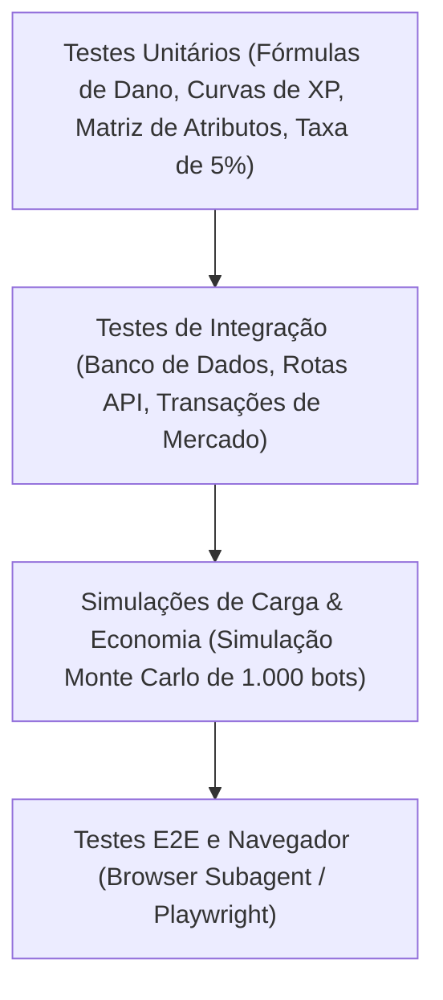

# Plano de Testes e Garantia de Qualidade (QA) — NoobRPG

## 1. Estratégia de Testes (Pirâmide de Testes)

O plano de testes assegura que nenhuma mecânica de progressão, combate ou economia sofra regressões silenciosas durante o desenvolvimento.

---

## 2. Cobertura por Camada

### 2.1 Testes Unitários (Camada `@noobrpg/shared` e Servidor)
- **Fórmulas de XP:**
  - Validação da equação $XP_{total}(L) = 100(L-1)^2 + 400(L-1)$ para todos os níveis de 1 a 50.
  - Garantia de que $XP_{proximo}(L)$ é estritamente crescente e positivo.
- **Fórmulas de Dano:**
  - Garantia de que o dano mínimo nunca é menor que 1, mesmo quando $\text{Defesa} \gg \text{Ataque}$.
  - Validação do cálculo de acerto crítico e resistências elementais.
- **Cálculo da Taxa de Mercado:**
  - Teste de arredondamento da taxa de $5\%$ (ex: valor 1.000 gold deduz exatamente 50 gold; valores ímpares arredondam a favor da destruição do sistema).

### 2.2 Testes de Integração (Camada de Banco de Dados e Serviços)
- **Persistência de Inventário:**
  - Adição de item em slot livre.
  - Tentativa de adicionar item com inventário cheio (lança erro controlado sem corrupção).
  - Empilhamento de consumíveis até o limite máximo (`stackSize: 99`).
- **Atomicidade do Mercado (Race Conditions):**
  - Simulação de dois compradores disparando a compra do mesmo item de mercado no mesmo milissegundo: exatamente uma compra é aprovada e a segunda recebe `ITEM_ALREADY_SOLD`.
  - Tentativa de compra com saldo insuficiente: a transação é revertida integralmente e o item permanece à venda.

### 2.3 Simulações Econômicas e de Balanceamento
- **Simulador de Balanceamento:** Script automatizado que roda batalhas virtuais entre cada classe e os monstros do jogo em diferentes faixas de nível para medir:
  - TTK (Time to Kill) em segundos.
  - Consumo de poções por hora.
  - Taxa de mortalidade do jogador por região.
- **Simulador de Inflação:** Simulação de 1.000 jogadores virtuais por 30 ciclos diários para monitorar o volume total de Gold circulante e certificar que os sumidouros (sinks) mantêm o valor da moeda estável.

---

## 3. Matriz de Critérios de Aceite para Cada Fase

| Fase | Funcionalidade Principal | Critério de Aceite Objetivo |
| :--- | :--- | :--- |
| **Fase 0** | Documentação e Planejamento | 10 documentos canônicos aprovados e repositório estruturado. |
| **Fase 1** | Protótipo Jogável | Movimentação 2D a 60 FPS, colisão perfeita com cenário e animações 4-direções fluidas. |
| **Fase 2** | Combate e Classes | 4 classes atacando e sofrendo dano determinístico, morte/respawn funcionais e concessão de XP conforme a fórmula. |
| **Fase 3** | Itens e Inventário | Drop de monstros ao morrer, coleta ao aproximar, inventário visual em grade e equipamentos alterando atributos. |
| **Fase 4** | Persistência e Contas | Registro/login com senha hasheada, salvamento automático no PostgreSQL e carregamento fiel do personagem. |
| **Fase 5** | Economia e Mercado | NPC Shop com compra/venda, Player Marketplace com 5% de taxa e transações atômicas sem duplicação. |
| **Fase 6** | Multiplayer Completo | Sincronização de 20+ jogadores simultâneos na mesma sala com latência suave e interpolação de movimento. |
