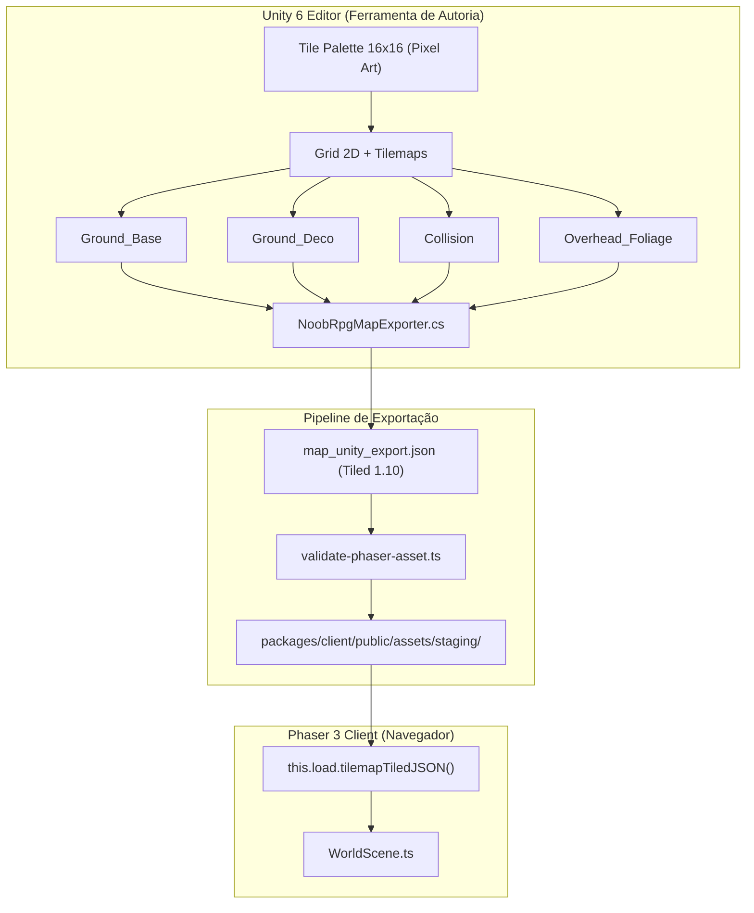

# Guia do Pipeline de Criação de Assets: Unity → Phaser 3

**Projeto:** NoobRPG  
**Versão do Unity Suportada:** Unity 6 (`6000.6.4f1`+)  
**Motor Final do Jogo:** Phaser 3.88.2 (HTML5 / TypeScript no Navegador)

---

## 1. Visão Geral da Arquitetura

O Unity é utilizado exclusivamente como **ferramenta de criação e autoria visual de conteúdo (mapas, tilesets e animações de personagens)**. O jogo executado pelo jogador continua sendo **100% web em Phaser 3**, consumindo arquivos estáticos JSON e PNG exportados.



---

## 2. Convenções Obrigatórias para Artistas no Unity

Para que qualquer mapa ou spritesheet criado no Unity seja compatível com o Phaser 3 e com o servidor autoritativo do NoobRPG:

### 2.1 Configuração de Tilemaps no Unity
1. Crie uma `Grid` 2D com `Cell Size: (1, 1, 0)` ou `(16, 16, 0)` dependendo da escala de Pixels Per Unit.
2. Crie 4 GameObjects filhos com o componente `Tilemap` e `TilemapRenderer`:
   - `Ground_Base`: grama, terra, pedras do piso (sem colisão).
   - `Ground_Deco`: caminhos de terra, flores, pedregulhos, sombras no solo.
   - `Collision`: água, cercas, paredes, árvores intransponíveis (qualquer tile pintado nesta camada gerará colisão física sólida).
   - `Overhead_Foliage`: copas de árvores e telhados que renderizam acima dos personagens.
3. Importação das Texturas do Tileset:
   - **Texture Type:** Sprite (2D and UI)
   - **Sprite Mode:** Multiple (16x16 por tile)
   - **Pixels Per Unit:** 16
   - **Filter Mode:** Point (no filter) — **crítico para evitar borrão de pixel art**
   - **Compression:** None

### 2.2 Exportando o Mapa
- **Pela Interface do Unity:**
  No menu superior, clique em `Tools > NoobRPG > Export Active Tilemap to Phaser JSON`.
- **Por Linha de Comando (CI/CD Headless):**
  ```bash
  unity run -- -executeMethod NoobRPG.EditorPipeline.NoobRpgMapExporter.ExportFromCommandLine -mapOutput packages/client/public/assets/staging/meu_mapa.json
  ```

---

## 3. Validação Automatizada de Assets

Antes de promover qualquer asset da pasta `staging/` para `maps/`:

```bash
cmd.exe /c "npx tsx tools/unity-asset-pipeline/scripts/validate-phaser-asset.ts packages/client/public/assets/staging/meu_mapa.json"
```

Critérios verificados automaticamente:
- Orientação ortogonal (`orthogonal`).
- Tamanho de tile estritamente de $16 \times 16$ pixels.
- Presença das camadas canônicas obrigatórias.
- Integridade do array numérico de GIDs (sem valores NaN ou nulos).

---

## 4. Spritesheets e Animações de Personagens

1. Selecione os Sprites na aba Project do Unity.
2. Clique em `Tools > NoobRPG > Export Selected Sprites as Horizontal Sheet`.
3. O exporter empacotará os quadros em uma linha horizontal contínua em formato PNG RGBA32 de 32 bits, acompanhado de um `.meta.json` informando o `frameWidth`, `frameHeight` e `originX: 0.5, originY: 1.0` (ancoragem no pé).
